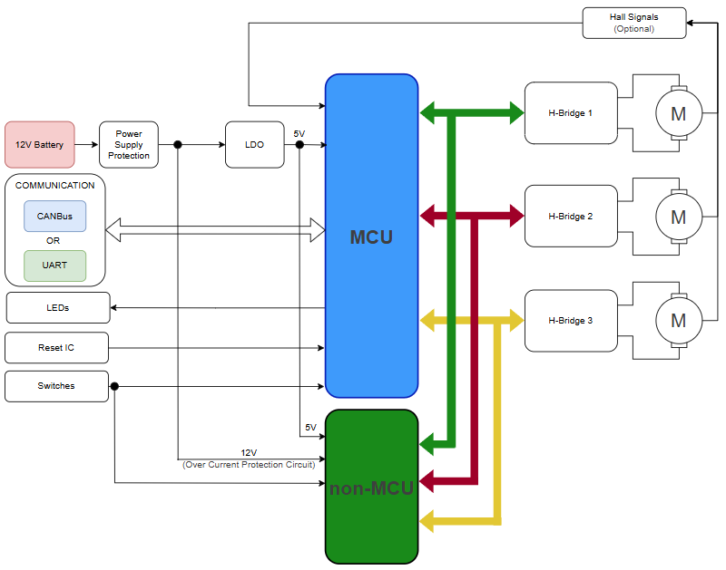
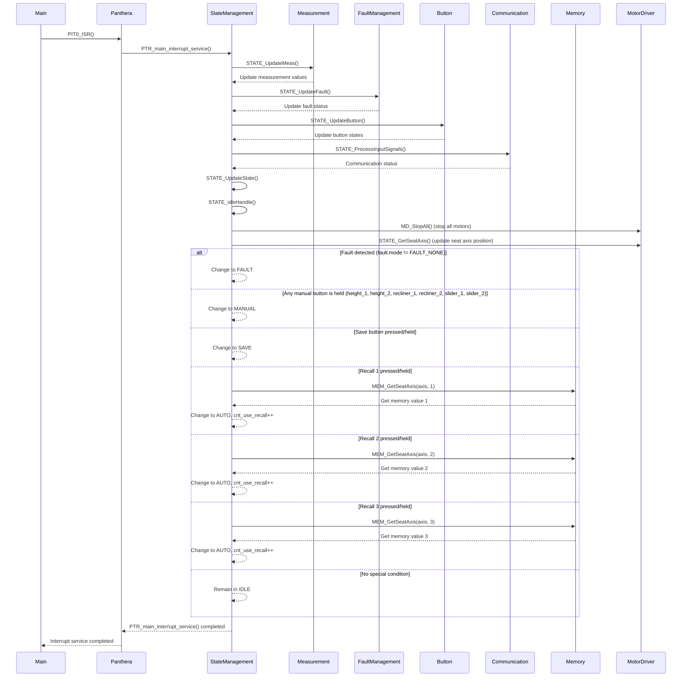
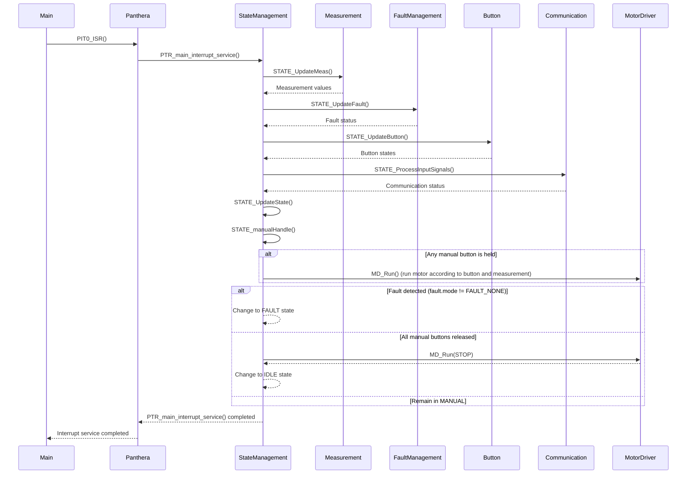
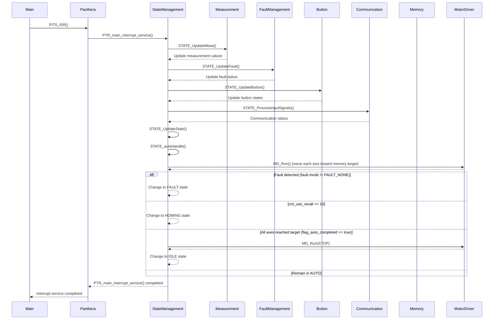
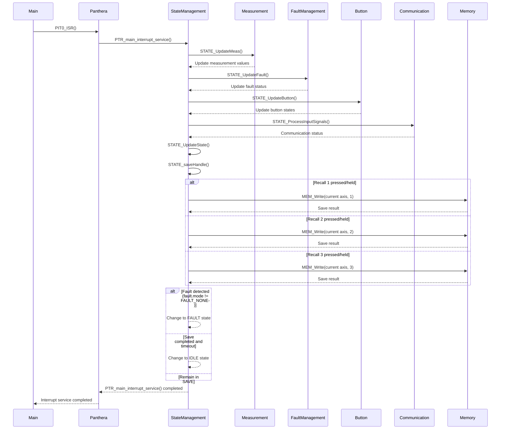
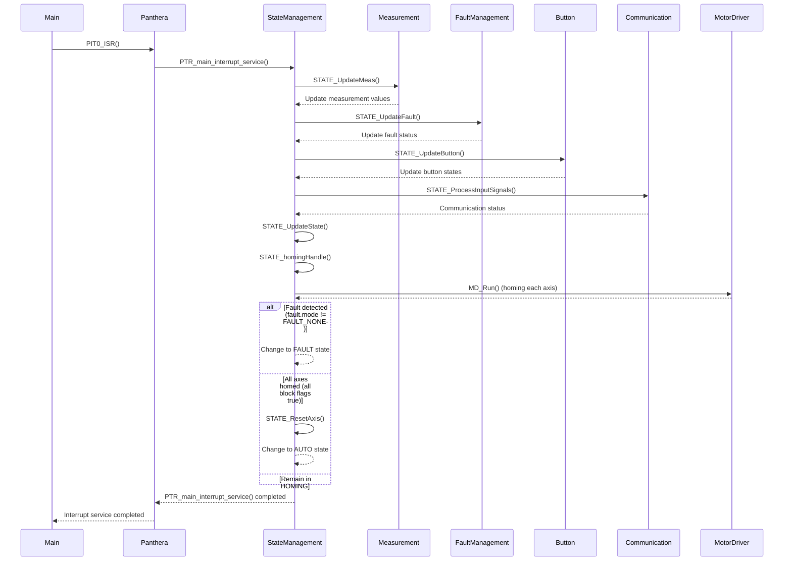
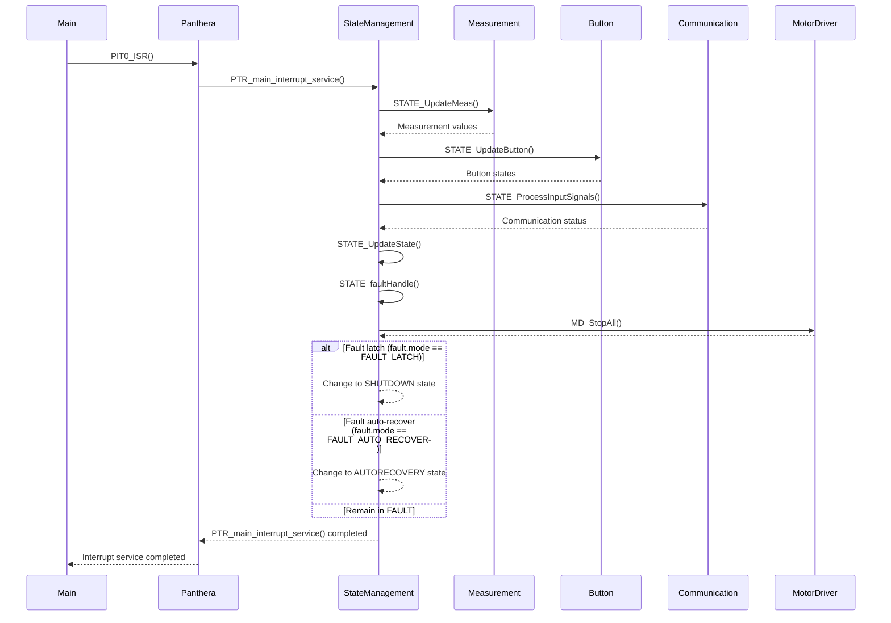
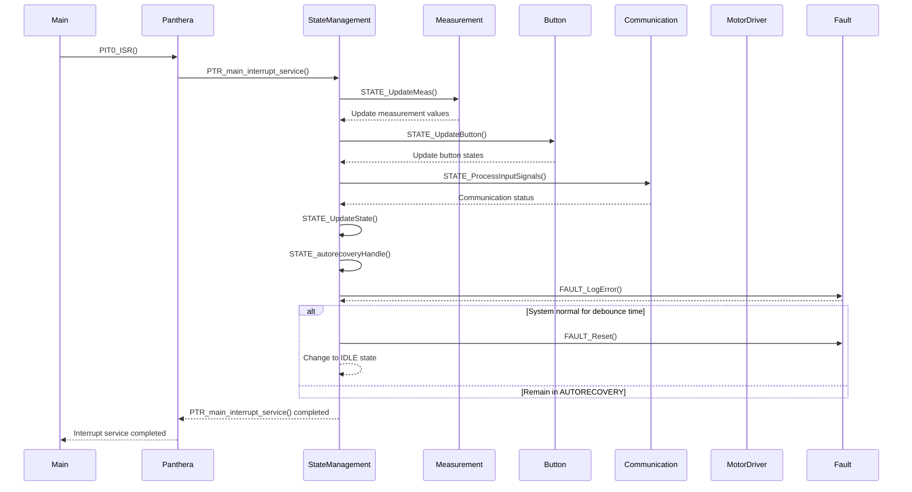
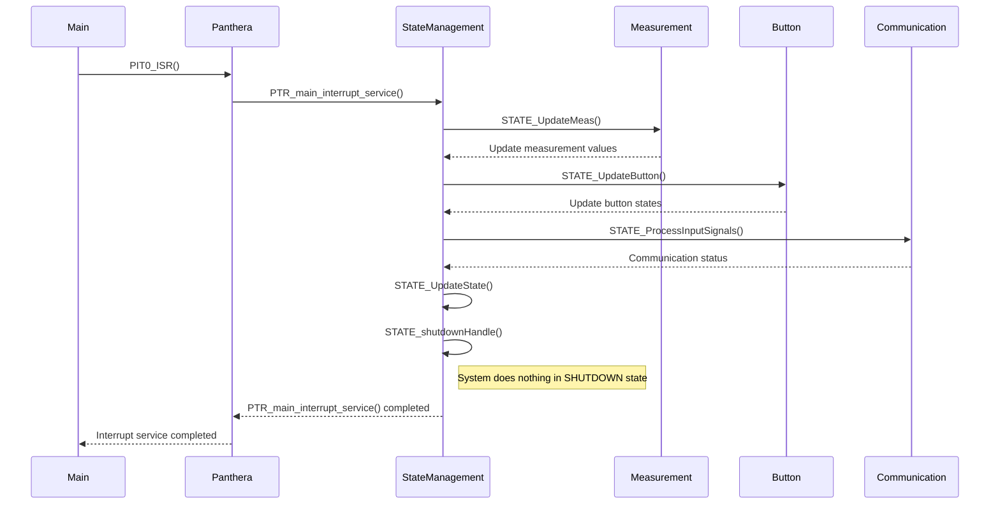

<i>Firmware Development Documentation</i>
<h2><i><b>Power Car Seat - Panthera Project</b></i></h2>

<h2><b>ABSTRACT</b></h2>

This document provides comprehensive technical documentation for the Panthera firmware, detailing its architecture, hardware-software interface, protection mechanisms, state machines, and API summary. It serves as a reference for developers and engineers involved in the design, implementation, and maintenance of the firmware, ensuring clarity and consistency throughout the development lifecycle.

<h2><b>Table of Contents</b></h2>

- [**1. Overview**](#1-overview)
- [**2. Hardware-software Interface**](#2-hardware-software-interface)
    - [**2.1 Power Pins**](#21-power-pins)
    - [**2.2 Gpio Pins**](#22-gpio-pins)
    - [**2.3 Adc Pins**](#23-adc-pins)
    - [**Pin Mapping Table**](#pin-mapping-table)
- [**3. System Architecture**](#3-system-architecture)
  - [**3.1 System Diagram**](#31-system-diagram)
- [**4. Protection**](#4-protection)
- [**5. Detail State Machine**](#5-detail-state-machine)
  - [**5.1 IDLE State**](#51-idle-state)
  - [**5.3 AUTO State**](#53-auto-state)
  - [**5.4 SAVE State**](#54-save-state)
  - [**5.5 HOMING State**](#55-homing-state)
  - [**5.6 FAULT State**](#56-fault-state)
  - [**5.7 AUTORECOVERY State**](#57-autorecovery-state)
  - [**5.8 SHUTDOWN State**](#58-shutdown-state)
- [**6. Api Summary**](#6-api-summary)
  - [**6.1 Driver**](#61-driver)
  - [**6.2 Middleware**](#62-middleware)
  - [**6.3 Application**](#63-application)
- [**Revision Note**](#revision-note)

## **1. Overview**

_Describe the general purpose, scope, and goals of the firmware._

## **2. Hardware-software Interface**

#### **2.1 Power Pins**
<table class="hw-table">
<thead>
<tr>
<th>Pin No</th>
<th>Pin Configuration</th>
<th>Pin Function</th>
<th>Pin Direction</th>
<th>Signal / function</th>
<th>Purpose</th>
<th>Status Pin / Scale of Analog</th>
</tr>
</thead>
<tbody>
<tr><td>11</td><td>VDD_LV_FLA/VDD_LV</td><td>POWER</td><td>In</td><td>VDD_LV_FLA/VDD_LV</td><td>Power Supply</td><td>5V</td></tr>
<tr><td>12</td><td>VDD_HV_IO_MAIN_1</td><td>POWER</td><td>In</td><td>VDD_HV_IO_MAIN_1</td><td>Power Supply</td><td>5V</td></tr>
<tr><td>19</td><td>VSS_HV_ADR_S</td><td>POWER</td><td>In</td><td>VSS_HV_ADR_S</td><td>Ground of power supply</td><td>0V</td></tr>
<tr><td>20</td><td>VDD_HV_ADR_S</td><td>POWER</td><td>In</td><td>VDD_HV_ADR_S</td><td>Power Supply</td><td>5V</td></tr>
<tr><td>21</td><td>VSS_HV_ADV_S</td><td>POWER</td><td>In</td><td>VSS_HV_ADV_S</td><td>Ground of power supply</td><td>0V</td></tr>
<tr><td>22</td><td>VDD_HV_ADV_S</td><td>POWER</td><td>In</td><td>VDD_HV_ADV_S</td><td>Power Supply</td><td>5V</td></tr>
<tr><td>27</td><td>VDD_LV_ADC_S/VDD_LV</td><td>POWER</td><td>In</td><td>VDD_LV_ADC_S/VDD_LV</td><td>Power Supply</td><td>5V</td></tr>
<tr><td>28</td><td>VDD_HV_IO_MAIN_2</td><td>POWER</td><td>In</td><td>VDD_HV_IO_MAIN_2</td><td>Power Supply</td><td>5V</td></tr>
<tr><td>33</td><td>VDD_LV_1</td><td>POWER</td><td>In</td><td>VDD_LV_1</td><td>Power Supply</td><td>5V</td></tr>
<tr><td>34</td><td>VDD_HV_IO_MAIN_3</td><td>POWER</td><td>In</td><td>VDD_HV_IO_MAIN_3</td><td>Power Supply</td><td>5V</td></tr>
<tr><td>35</td><td>VSS_HV_OSC</td><td>POWER</td><td>In</td><td>VSS_HV_OSC</td><td>Ground of power supply</td><td>0V</td></tr>
<tr><td>38</td><td>VDD_HV_OSC</td><td>POWER</td><td>In</td><td>VDD_HV_OSC</td><td>Power Supply</td><td>5V</td></tr>
<tr><td>47</td><td>VDD_LV_2</td><td>POWER</td><td>In</td><td>VDD_LV_2</td><td>Power Supply</td><td>5V</td></tr>
<tr><td>49</td><td>VDD_HV_IO_MAIN_4</td><td>POWER</td><td>In</td><td>VDD_HV_IO_MAIN_4</td><td>Power Supply</td><td>5V</td></tr>
<tr><td>57</td><td>VDD_HV_FLA/VDD_HV_IO_MAIN</td><td>POWER</td><td>In</td><td>VDD_HV_FLA/VDD_HV_IO_MAIN</td><td>Power Supply</td><td>5V</td></tr>
<tr><td>65</td><td>EP</td><td>POWER</td><td>In/Out</td><td>EP</td><td>GND</td><td>0V</td></tr>
</tbody>
</table>

#### **2.2 Gpio Pins**
<table class="hw-table">
<thead>
<tr>
<th>Pin No</th>
<th>Pin Configuration</th>
<th>Pin Function</th>
<th>Pin Direction</th>
<th>Signal / function</th>
<th>Purpose</th>
<th>Status Pin / Scale of Analog</th>
</tr>
</thead>
<tbody>
<tr><td>1</td><td>PD[14]</td><td>GPIO</td><td>In</td><td>RECLIER_1</td><td>Return seatback upright</td><td>Logic 0 (0V): Button Released Logic 1 (5V): Button Pressed</td></tr>
<tr><td>2</td><td>PD[15]</td><td>GPIO</td><td>In</td><td>RECLIER_2</td><td>Seatback reclining</td><td>Logic 0 (0V): Button Released Logic 1 (5V): Button Pressed</td></tr>
<tr><td>3</td><td>PC[4]</td><td>GPIO</td><td>Out</td><td>INB_3</td><td>Signal used to detect the rotation direction of the motor 2</td><td>Logic 0 (0V) Logic 1 (5V)</td></tr>
<tr><td>4</td><td>PC[3]</td><td>GPIO</td><td>Out</td><td>INA_3</td><td>Signal used to detect the rotation direction of the motor 3</td><td>Logic 0 (0V) Logic 1 (5V)</td></tr>
<tr><td>5</td><td>PC[2]</td><td>GPIO</td><td>Out</td><td>SEL0_3</td><td>Configure MultiSense Monioring for Motor 3</td><td>Logic 0 (0V) Logic 1 (5V)</td></tr>
<tr><td>6</td><td>PC[1]</td><td>GPIO</td><td>Out</td><td>MulEN_3</td><td>Enable/ Disable MultiSense Monitoring Motors 3</td><td>Logic 0 (0V) Logic 1 (5V)</td></tr>
<tr><td>8</td><td>PD[12]</td><td>GPIO</td><td>Out</td><td>PWM_1</td><td>PWM of Motor 1</td><td>Logic 0 (0V) Logic 1 (5V)</td></tr>
<tr><td>9</td><td>PD[13]</td><td>GPIO</td><td>In</td><td>SLIDER_1</td><td>Seat Forward Adjustment Button</td><td>Logic 0 (0V): Button Released Logic 1 (5V): Button Pressed</td></tr>
<tr><td>10</td><td>PE[3]</td><td>GPIO</td><td>In</td><td>SLIDER_2</td><td>Seat Backward Adjustment Button</td><td>Logic 0 (0V): Button Released Logic 1 (5V): Button Pressed</td></tr>
<tr><td>13</td><td>PI[1]</td><td>GPIO</td><td>In</td><td>HIEGHT_1</td><td>Raise the seat</td><td>Logic 0 (0V): Button Released Logic 1 (5V): Button Pressed</td></tr>
<tr><td>14</td><td>PI[2]</td><td>GPIO</td><td>In</td><td>HIEGHT_2</td><td>Lower the seat</td><td>Logic 0 (0V): Button Released Logic 1 (5V): Button Pressed</td></tr>
<tr><td>15</td><td>PI[3]</td><td>GPIO</td><td>In</td><td>RECALL_3</td><td>Auto move seat to position 3</td><td>Logic 0 (0V): Button Released Logic 1 (5V): Button Pressed</td></tr>
<tr><td>16</td><td>PI[4]</td><td>GPIO</td><td>In</td><td>RECALL_2</td><td>Auto move seat to position 2</td><td>Logic 0 (0V): Button Released Logic 1 (5V): Button Pressed</td></tr>
<tr><td>17</td><td>PI[6]</td><td>GPIO</td><td>In</td><td>SAVE</td><td>Save position</td><td>Logic 0 (0V): Button Released Logic 1 (5V): Button Pressed</td></tr>
<tr><td>18</td><td>PI[7]</td><td>GPIO</td><td>In</td><td>RECALL_1</td><td>Auto move seat to position 1</td><td>Logic 0 (0V): Button Released Logic 1 (5V): Button Pressed</td></tr>
<tr><td>23</td><td>PG[10]</td><td>GPIO</td><td>In</td><td>HALL_1</td><td>Hall Signal Motor 1</td><td>Logic 0 (0V): Low Logic 1 (5V): High</td></tr>
<tr><td>24</td><td>PG[11]</td><td>GPIO</td><td>In</td><td>HALL_2</td><td>Hall Signal Motor 2</td><td>Logic 0 (0V): Low Logic 1 (5V): High</td></tr>
<tr><td>29</td><td>PB[11]</td><td>GPIO</td><td>Out</td><td>INB_2</td><td>Signal used to detect the rotation direction of the motor 2</td><td>Logic 0 (0V) Logic 1 (5V)</td></tr>
<tr><td>31</td><td>PB[9]</td><td>GPIO</td><td>Out</td><td>INA_2</td><td>Signal used to detect the rotation direction of the motor 2</td><td>Logic 0 (0V) Logic 1 (5V)</td></tr>
<tr><td>46</td><td>PM[14]</td><td>GPIO</td><td>Out</td><td>INA_1</td><td>Signal used to detect the rotation direction of the motor 1</td><td>Logic 0 (0V) Logic 1 (5V)</td></tr>
<tr><td>48</td><td>PD[5]</td><td>GPIO</td><td>Out</td><td>INB_1</td><td>Signal used to detect the rotation direction of the motor 1</td><td>Logic 0 (0V) Logic 1 (5V)</td></tr>
<tr><td>52</td><td>PA[10]</td><td>GPIO</td><td>Out</td><td>MulEN_2</td><td>Enable/ Disable MultiSense Monitoring Motor 2</td><td>Logic 0 (0V) Logic 1 (5V)</td></tr>
<tr><td>53</td><td>PA[11]</td><td>GPIO</td><td>Out</td><td>SEL0_2</td><td>Configure MultiSense Monioring for Motor 2</td><td>Logic 0 (0V) Logic 1 (5V)</td></tr>
<tr><td>54</td><td>PE[10]</td><td>GPIO</td><td>Out</td><td>PWM_3</td><td>PWM of Motor 2</td><td>Logic 0 (0V) Logic 1 (5V)</td></tr>
<tr><td>55</td><td>PE[11]</td><td>GPIO</td><td>Out</td><td>SEL1_3</td><td>Configure MultiSense Monioring for Motor 3</td><td>Logic 0 (0V) Logic 1 (5V)</td></tr>
<tr><td>56</td><td>PH[4]</td><td>GPIO</td><td>Out</td><td>SEL0_1</td><td>Configure MultiSense Monioring for Motor 1</td><td>Logic 0 (0V) Logic 1 (5V)</td></tr>
<tr><td>58</td><td>PD[0]</td><td>GPIO</td><td>In</td><td>TW</td><td>Advanced Thermal warning output</td><td>Logic 0 (0V): Low Logic 1 (5V): High</td></tr>
<tr><td>59</td><td>PC[15]</td><td>GPIO</td><td>Out</td><td>SEL1_2</td><td>Configure MultiSense Monioring for Motor 2</td><td>Logic 0 (0V) Logic 1 (5V)</td></tr>
<tr><td>60</td><td>PC[14]</td><td>GPIO</td><td>Out</td><td>SEL1_1</td><td>Configure MultiSense Monioring for Motor 1</td><td>Logic 0 (0V) Logic 1 (5V)</td></tr>
<tr><td>61</td><td>PC[13]</td><td>GPIO</td><td>Out</td><td>PWM_2</td><td>PWM of Motor 2</td><td>Logic 0 (0V) Logic 1 (5V)</td></tr>
<tr><td>62</td><td>PC[12]</td><td>GPIO</td><td>In</td><td>HALL_3</td><td>Hall Signal Motor 3</td><td>Logic 0 (0V): Low Logic 1 (5V): High</td></tr>
<tr><td>63</td><td>PF[3]</td><td>GPIO</td><td>Out</td><td>MulEN_1</td><td>Enable/ Disable MultiSense Monitoring Motor 1</td><td>Logic 0 (0V) Logic 1 (5V)</td></tr>
</tbody>
</table>

#### **2.3 Adc Pins**
<table class="hw-table">
<thead>
<tr>
<th>Pin No</th>
<th>Pin Configuration</th>
<th>Pin Function</th>
<th>Pin Direction</th>
<th>Signal / function</th>
<th>Purpose</th>
<th>Status Pin / Scale of Analog</th>
</tr>
</thead>
<tbody>
<tr><td>25</td><td>PG[12]</td><td>ADC</td><td>In</td><td>5V_FB</td><td>Feedback LDO 5V to check Power Supply</td><td>0V - 5V</td></tr>
<tr><td>26</td><td>PD[11]</td><td>ADC</td><td>In</td><td>MulSens_3</td><td>Current input of Motor 3</td><td>0V/0A - 5V/22.5A, Max Software: 20V</td></tr>
<tr><td>30</td><td>PB[10]</td><td>ADC</td><td>In</td><td>MulSens_2</td><td>Current input of Motor 2</td><td>0V/0A - 5V/22.5A, Max Software: 20V</td></tr>
<tr><td>32</td><td>PB[8]</td><td>ADC</td><td>In</td><td>MulSens_1</td><td>Current input of Motor 1</td><td>0V/0A - 5V/25A, Max Software: 20V</td></tr>
</tbody>
</table>

#### **Pin Mapping Table**
<table class="hw-table">
<thead>
<tr>
<th>Pin No</th>
<th>Pin Configuration</th>
<th>Pin Function</th>
<th>Pin Direction</th>
<th>Signal / function</th>
<th>Purpose</th>
<th>Status Pin / Scale of Analog</th>
</tr>
</thead>
<tbody>
<tr><td>1</td><td>PD[14]</td><td>GPIO</td><td>In</td><td>RECLIER_1</td><td>Return seatback upright</td><td>Logic 0 (0V): Button Released Logic 1 (5V): Button Pressed</td></tr>
<tr><td>2</td><td>PD[15]</td><td>GPIO</td><td>In</td><td>RECLIER_2</td><td>Seatback reclining</td><td>Logic 0 (0V): Button Released Logic 1 (5V): Button Pressed</td></tr>
<tr><td>3</td><td>PC[4]</td><td>GPIO</td><td>Out</td><td>INB_3</td><td>Signal used to detect the rotation direction of the motor 2</td><td>Logic 0 (0V) Logic 1 (5V)</td></tr>
<tr><td>4</td><td>PC[3]</td><td>GPIO</td><td>Out</td><td>INA_3</td><td>Signal used to detect the rotation direction of the motor 3</td><td>Logic 0 (0V) Logic 1 (5V)</td></tr>
<tr><td>5</td><td>PC[2]</td><td>GPIO</td><td>Out</td><td>SEL0_3</td><td>Configure MultiSense Monioring for Motor 3</td><td>Logic 0 (0V) Logic 1 (5V)</td></tr>
<tr><td>6</td><td>PC[1]</td><td>GPIO</td><td>Out</td><td>MulEN_3</td><td>Enable/ Disable MultiSense Monitoring Motors 3</td><td>Logic 0 (0V) Logic 1 (5V)</td></tr>
<tr><td>7</td><td>PE[2]</td><td>Reset</td><td>In</td><td>RST</td><td>Reset MCU</td><td>None</td></tr>
<tr><td>8</td><td>PD[12]</td><td>GPIO</td><td>Out</td><td>PWM_1</td><td>PWM of Motor 1</td><td>Logic 0 (0V) Logic 1 (5V)</td></tr>
<tr><td>9</td><td>PD[13]</td><td>GPIO</td><td>In</td><td>SLIDER_1</td><td>Seat Forward Adjustment Button</td><td>Logic 0 (0V): Button Released Logic 1 (5V): Button Pressed</td></tr>
<tr><td>10</td><td>PE[3]</td><td>GPIO</td><td>In</td><td>SLIDER_2</td><td>Seat Backward Adjustment Button</td><td>Logic 0 (0V): Button Released Logic 1 (5V): Button Pressed</td></tr>
<tr><td>11</td><td>VDD_LV_FLA/VDD_LV</td><td>POWER</td><td>In</td><td>VDD_LV_FLA/VDD_LV</td><td>Power Supply</td><td>5V</td></tr>
<tr><td>12</td><td>VDD_HV_IO_MAIN_1</td><td>POWER</td><td>In</td><td>VDD_HV_IO_MAIN_1</td><td>Power Supply</td><td>5V</td></tr>
<tr><td>13</td><td>PI[1]</td><td>GPIO</td><td>In</td><td>HIEGHT_1</td><td>Raise the seat</td><td>Logic 0 (0V): Button Released Logic 1 (5V): Button Pressed</td></tr>
<tr><td>14</td><td>PI[2]</td><td>GPIO</td><td>In</td><td>HIEGHT_2</td><td>Lower the seat</td><td>Logic 0 (0V): Button Released Logic 1 (5V): Button Pressed</td></tr>
<tr><td>15</td><td>PI[3]</td><td>GPIO</td><td>In</td><td>RECALL_3</td><td>Auto move seat to position 3</td><td>Logic 0 (0V): Button Released Logic 1 (5V): Button Pressed</td></tr>
<tr><td>16</td><td>PI[4]</td><td>GPIO</td><td>In</td><td>RECALL_2</td><td>Auto move seat to position 2</td><td>Logic 0 (0V): Button Released Logic 1 (5V): Button Pressed</td></tr>
<tr><td>17</td><td>PI[6]</td><td>GPIO</td><td>In</td><td>SAVE</td><td>Save position</td><td>Logic 0 (0V): Button Released Logic 1 (5V): Button Pressed</td></tr>
<tr><td>18</td><td>PI[7]</td><td>GPIO</td><td>In</td><td>RECALL_1</td><td>Auto move seat to position 1</td><td>Logic 0 (0V): Button Released Logic 1 (5V): Button Pressed</td></tr>
<tr><td>19</td><td>VSS_HV_ADR_S</td><td>POWER</td><td>In</td><td>VSS_HV_ADR_S</td><td>Ground of power supply</td><td>0V</td></tr>
<tr><td>20</td><td>VDD_HV_ADR_S</td><td>POWER</td><td>In</td><td>VDD_HV_ADR_S</td><td>Power Supply</td><td>5V</td></tr>
<tr><td>21</td><td>VSS_HV_ADV_S</td><td>POWER</td><td>In</td><td>VSS_HV_ADV_S</td><td>Ground of power supply</td><td>0V</td></tr>
<tr><td>22</td><td>VDD_HV_ADV_S</td><td>POWER</td><td>In</td><td>VDD_HV_ADV_S</td><td>Power Supply</td><td>5V</td></tr>
<tr><td>23</td><td>PG[10]</td><td>GPIO</td><td>In</td><td>HALL_1</td><td>Hall Signal Motor 1</td><td>Logic 0 (0V): Low Logic 1 (5V): High</td></tr>
<tr><td>24</td><td>PG[11]</td><td>GPIO</td><td>In</td><td>HALL_2</td><td>Hall Signal Motor 2</td><td>Logic 0 (0V): Low Logic 1 (5V): High</td></tr>
<tr><td>25</td><td>PG[12]</td><td>ADC</td><td>In</td><td>5V_FB</td><td>Feedback LDO 5V to check Power Supply</td><td>0V - 5V</td></tr>
<tr><td>26</td><td>PD[11]</td><td>ADC</td><td>In</td><td>MulSens_3</td><td>Current input of Motor 3</td><td>0V/0A - 5V/22.5A, Max Software: 20V</td></tr>
<tr><td>27</td><td>VDD_LV_ADC_S/VDD_LV</td><td>POWER</td><td>In</td><td>VDD_LV_ADC_S/VDD_LV</td><td>Power Supply</td><td>5V</td></tr>
<tr><td>28</td><td>VDD_HV_IO_MAIN_2</td><td>POWER</td><td>In</td><td>VDD_HV_IO_MAIN_2</td><td>Power Supply</td><td>5V</td></tr>
<tr><td>29</td><td>PB[11]</td><td>GPIO</td><td>Out</td><td>INB_2</td><td>Signal used to detect the rotation direction of the motor 2</td><td>Logic 0 (0V) Logic 1 (5V)</td></tr>
<tr><td>30</td><td>PB[10]</td><td>ADC</td><td>In</td><td>MulSens_2</td><td>Current input of Motor 2</td><td>0V/0A - 5V/22.5A, Max Software: 20V</td></tr>
<tr><td>31</td><td>PB[9]</td><td>GPIO</td><td>Out</td><td>INA_2</td><td>Signal used to detect the rotation direction of the motor 2</td><td>Logic 0 (0V) Logic 1 (5V)</td></tr>
<tr><td>32</td><td>PB[8]</td><td>ADC</td><td>In</td><td>MulSens_1</td><td>Current input of Motor 1</td><td>0V/0A - 5V/25A, Max Software: 20V</td></tr>
<tr><td>33</td><td>VDD_LV_1</td><td>POWER</td><td>In</td><td>VDD_LV_1</td><td>Power Supply</td><td>5V</td></tr>
<tr><td>34</td><td>VDD_HV_IO_MAIN_3</td><td>POWER</td><td>In</td><td>VDD_HV_IO_MAIN_3</td><td>Power Supply</td><td>5V</td></tr>
<tr><td>35</td><td>VSS_HV_OSC</td><td>POWER</td><td>In</td><td>VSS_HV_OSC</td><td>Ground of power supply</td><td>0V</td></tr>
<tr><td>36</td><td>EXTAL</td><td>XTAL</td><td>In</td><td>EXTAL</td><td>OSC32_IN</td><td>None</td></tr>
<tr><td>37</td><td>XTAL</td><td>XTAL</td><td>In</td><td>XTAL</td><td>OSC32_OUT</td><td>None</td></tr>
<tr><td>38</td><td>VDD_HV_OSC</td><td>POWER</td><td>In</td><td>VDD_HV_OSC</td><td>Power Supply</td><td>5V</td></tr>
<tr><td>39</td><td>PA[8]</td><td>JTAG</td><td>In</td><td>TDI</td><td>Debug</td><td>None</td></tr>
<tr><td>40</td><td>PA[7]</td><td>JTAG</td><td>In</td><td>TMS</td><td>Debug</td><td>None</td></tr>
<tr><td>41</td><td>PA[9]</td><td>JTAG</td><td>In</td><td>TDO</td><td>Debug</td><td>None</td></tr>
<tr><td>42</td><td>PA[5]</td><td>JTAG</td><td>In</td><td>JCOMP</td><td>Debug</td><td>None</td></tr>
<tr><td>43</td><td>PA[6]</td><td>JTAG</td><td>In</td><td>TCK</td><td>Debug</td><td>None</td></tr>
<tr><td>44</td><td>TESTMODE</td><td>None</td><td>In/Out</td><td>TESTMODE</td><td>None</td><td>None</td></tr>
<tr><td>45</td><td>PORST</td><td>Reset</td><td>In</td><td>PORST</td><td>Positive Reset</td><td>None</td></tr>
<tr><td>46</td><td>PM[14]</td><td>GPIO</td><td>Out</td><td>INA_1</td><td>Signal used to detect the rotation direction of the motor 1</td><td>Logic 0 (0V) Logic 1 (5V)</td></tr>
<tr><td>47</td><td>VDD_LV_2</td><td>POWER</td><td>In</td><td>VDD_LV_2</td><td>Power Supply</td><td>5V</td></tr>
<tr><td>48</td><td>PD[5]</td><td>GPIO</td><td>Out</td><td>INB_1</td><td>Signal used to detect the rotation direction of the motor 1</td><td>Logic 0 (0V) Logic 1 (5V)</td></tr>
<tr><td>49</td><td>VDD_HV_IO_MAIN_4</td><td>POWER</td><td>In</td><td>VDD_HV_IO_MAIN_4</td><td>Power Supply</td><td>5V</td></tr>
<tr><td>50</td><td>PA[2]</td><td>Communication</td><td>Out</td><td>CAN_TX</td><td>CAN Communication</td><td>None</td></tr>
<tr><td>51</td><td>PA[1]</td><td>Communication</td><td>In</td><td>CAN_RX</td><td>CAN Communication</td><td>None</td></tr>
<tr><td>52</td><td>PA[10]</td><td>GPIO</td><td>Out</td><td>MulEN_2</td><td>Enable/ Disable MultiSense Monitoring Motor 2</td><td>Logic 0 (0V) Logic 1 (5V)</td></tr>
<tr><td>53</td><td>PA[11]</td><td>GPIO</td><td>Out</td><td>SEL0_2</td><td>Configure MultiSense Monioring for Motor 2</td><td>Logic 0 (0V) Logic 1 (5V)</td></tr>
<tr><td>54</td><td>PE[10]</td><td>GPIO</td><td>Out</td><td>PWM_3</td><td>PWM of Motor 2</td><td>Logic 0 (0V) Logic 1 (5V)</td></tr>
<tr><td>55</td><td>PE[11]</td><td>GPIO</td><td>Out</td><td>SEL1_3</td><td>Configure MultiSense Monioring for Motor 3</td><td>Logic 0 (0V) Logic 1 (5V)</td></tr>
<tr><td>56</td><td>PH[4]</td><td>GPIO</td><td>Out</td><td>SEL0_1</td><td>Configure MultiSense Monioring for Motor 1</td><td>Logic 0 (0V) Logic 1 (5V)</td></tr>
<tr><td>57</td><td>VDD_HV_FLA/VDD_HV_IO_MAIN</td><td>POWER</td><td>In</td><td>VDD_HV_FLA/VDD_HV_IO_MAIN</td><td>Power Supply</td><td>5V</td></tr>
<tr><td>58</td><td>PD[0]</td><td>GPIO</td><td>In</td><td>TW</td><td>Advanced Thermal warning output</td><td>Logic 0 (0V): Low Logic 1 (5V): High</td></tr>
<tr><td>59</td><td>PC[15]</td><td>GPIO</td><td>Out</td><td>SEL1_2</td><td>Configure MultiSense Monioring for Motor 2</td><td>Logic 0 (0V) Logic 1 (5V)</td></tr>
<tr><td>60</td><td>PC[14]</td><td>GPIO</td><td>Out</td><td>SEL1_1</td><td>Configure MultiSense Monioring for Motor 1</td><td>Logic 0 (0V) Logic 1 (5V)</td></tr>
<tr><td>61</td><td>PC[13]</td><td>GPIO</td><td>Out</td><td>PWM_2</td><td>PWM of Motor 2</td><td>Logic 0 (0V) Logic 1 (5V)</td></tr>
<tr><td>62</td><td>PC[12]</td><td>GPIO</td><td>In</td><td>HALL_3</td><td>Hall Signal Motor 3</td><td>Logic 0 (0V): Low Logic 1 (5V): High</td></tr>
<tr><td>63</td><td>PF[3]</td><td>GPIO</td><td>Out</td><td>MulEN_1</td><td>Enable/ Disable MultiSense Monitoring Motor 1</td><td>Logic 0 (0V) Logic 1 (5V)</td></tr>
<tr><td>64</td><td>PF[2]</td><td></td><td></td><td>WI</td><td></td><td></td></tr>
<tr><td>65</td><td>EP</td><td>POWER</td><td>In/Out</td><td>EP</td><td>GND</td><td>0V</td></tr>
</tbody>
</table>

## **3. System Architecture**

### **3.1 System Diagram**

## **4. Protection**

## **5. Detail State Machine**

<h3><b>5.1 IDLE State</b></h3>

**Description:**
System is waiting for user input or events. All motors are stopped, seat axis is updated, and the system monitors for button actions or faults to transition to other states.

**Flowchart:**

  
   
  <b>Figure 5.1 IDLE State Flowchart</b>

**Low-Level Sequence Diagram for IDLE State**

  <b>Figure 5.2 IDLE State Sequence Diagram</b>

<h3><b>5.2 MANUAL State</b></h3>

<b>Description:</b> 
User is manually controlling seat movement (height, recliner, slider) by holding the corresponding button. Motors run according to button actions until all are released, then return to IDLE.

**Flowchart:**

  
   
  <b>Figure 5.3 MANUAL State Flowchart</b>

**Low-Level Sequence Diagram for MANUAL State**

  <b>Figure 5.4 MANUAL State Sequence Diagram</b>

<h3><b>5.3 AUTO State</b></h3>

**Description:**
System automatically moves seat to a saved position (recall 1/2/3). Motors are controlled to reach target axis values from memory. When all axes reach their targets, returns to IDLE or transitions to HOMING if recall count limit is reached.

**Flowchart:**

  
   
  <b>Figure 5.5 AUTO State Flowchart</b>

**Low-Level Sequence Diagram for AUTO State**

  <b>Figure 5.6 AUTO State Sequence Diagram</b>

<h3><b>5.4 SAVE State</b></h3>

**Description:**
User requests to save current seat position. System writes current axis values to memory. After save and a delay, returns to IDLE.

**Flowchart:**

  
   
  <b>Figure 5.7 SAVE State Flowchart</b>

**Sequence Diagram:**

  <b>Figure 5.8 SAVE State Sequence Diagram</b>

<h3><b>5.5 HOMING State</b></h3>

**Description:**
System moves seat axes to their home (reference) positions for calibration or after multiple recalls. When all axes reach home, returns to AUTO and resets axis tracking.

**Flowchart:**

  
   
  <b>Figure 5.9 HOMING State Flowchart</b>

**Sequence Diagram:**

  <b>Figure 5.10 HOMING State Sequence Diagram</b>

<h3><b>5.6 FAULT State</b></h3>

**Description:**
A fault is detected (overcurrent, thermal, etc.). All motors are stopped for safety. System waits for fault to clear or transitions to SHUTDOWN/AUTORECOVERY depending on fault type.

**Flowchart:**

  
   
  <b>Figure 5.11 FAULT State Flowchart</b>

**Low-Level Sequence Diagram for FAULT State**

  <b>Figure 5.12 HOMING State Sequence Diagram</b>

<h3><b>5.7 AUTORECOVERY State</b></h3>

**Description:**
System attempts to recover from a recoverable fault. If system returns to normal, transitions back to IDLE and resets fault mode.

**Flowchart:**

  
   
  <b>Figure 5.13 AUTORECOVERY State Flowchart</b>

**Sequence Diagram:**

  <b>Figure 5.14 AUTORECOVERY State Sequence Diagram</b>

<h3><b>5.8 SHUTDOWN State</b></h3>

**Description:**
System enters safe shutdown due to a critical or latched fault. Motors remain stopped and system awaits reset or power cycle.

**Flowchart:**

  
   
  <b>Figure 5.15 SHUTDOWN State Flowchart</b>

**Sequence Diagram:**

  <b>Figure 5.16 SHUTDOWN State Sequence Diagram</b>

## **6. Api Summary**

### **6.1 Driver**

<table class="api-table">
<thead>
<tr>
<th>No.</th>
<th>API Function Signature</th>
<th>Layer</th>
<th>Library</th>
<th>Description</th>
</tr>
</thead>
<tbody>
<tr><td>1</td><td>int ADC_Init(ADC_TypeDef *pADC)</td><td>Driver</td><td>adc</td><td>Initialize ADC structure and driver</td></tr>
<tr><td>2</td><td>void ADC_startOfConversion(void)</td><td>Driver</td><td>adc</td><td>Start ADC conversion for configured channels</td></tr>
<tr><td>3</td><td>void saradcconf_conv_cb(SARADCDriver *saradcp)</td><td>Driver</td><td>adc</td><td>Callback for ADC conversion complete</td></tr>
<tr><td>4</td><td>void saradcconfdma_conv_cb(SARADCDriver*, uint16_t*, uint16_t)</td><td>Driver</td><td>adc</td><td>Callback for DMA-based ADC conversion (placeholder)</td></tr>
<tr><td>5</td><td>void EEPROM_Start(void)</td><td>Driver</td><td>eeprom_user</td><td>Initialize EEPROM</td></tr>
<tr><td>6</td><td>void EEPROM_Restart(void)</td><td>Driver</td><td>eeprom_user</td><td>Erase all data and restart EEPROM</td></tr>
<tr><td>7</td><td>void EEPROM_Write(uint32_t adc_value, uint16_t id)</td><td>Driver</td><td>eeprom_user</td><td>Write 32-bit value to EEPROM with specified ID</td></tr>
<tr><td>8</td><td>uint32_t EEPROM_Read(uint16_t id)</td><td>Driver</td><td>eeprom_user</td><td>Read 32-bit value from EEPROM by ID</td></tr>
<tr><td>9</td><td>void GPIO_SetPin(GPIO_TypeDef *pPin)</td><td>Driver</td><td>gpio</td><td>Set GPIO pin to high</td></tr>
<tr><td>10</td><td>void GPIO_ClearPin(GPIO_TypeDef *pPin)</td><td>Driver</td><td>gpio</td><td>Set GPIO pin to low</td></tr>
<tr><td>11</td><td>void GPIO_TogglePin(GPIO_TypeDef *pPin)</td><td>Driver</td><td>gpio</td><td>Toggle GPIO pin state</td></tr>
<tr><td>12</td><td>uint8_t GPIO_ReadPin(GPIO_TypeDef *pPin)</td><td>Driver</td><td>gpio</td><td>Read GPIO pin state (0/1)</td></tr>
<tr><td>13</td><td>void GPIO_Init(void)</td><td>Driver</td><td>gpio</td><td>Initialize all GPIO pins used in the system</td></tr>
<tr><td>14</td><td>void GPIO_Update(void)</td><td>Driver</td><td>gpio</td><td>Update all GPIO pin values to global structure</td></tr>
<tr><td>15</td><td>void UART_Init(void)</td><td>Driver</td><td>uart</td><td>Initialize UART, buffer, and state</td></tr>
<tr><td>16</td><td>void UART_HandleRequest(void)</td><td>Driver</td><td>uart</td><td>Handle UART data transmission/reception and status</td></tr>
<tr><td>17</td><td>void UART_TX_Callback(SerialDriver *sdp)</td><td>Driver</td><td>uart</td><td>Callback when UART transmission is complete</td></tr>
<tr><td>18</td><td>void *sbrk(ptrdiff_t incr)</td><td>Driver</td><td>uart</td><td>Heap memory allocation function (for malloc, weak symbol)</td></tr>
</tbody>
</table>

### **6.2 Middleware**

| No. | API Function Signature                                   | Layer      | Library           | Description                                                    |
|-----|----------------------------------------------------------|------------|-------------------|----------------------------------------------------------------|
| 1   | void BTN_GetGpioValue(GPIO_Input_TypeDef *pGpio)         | Middleware | Button            | Update button values from GPIO inputs                          |
| 2   | void BTN_Init(void)                                      | Middleware | Button            | Initialize all buttons in the system                           |
| 3   | void BTN_InitBtn(Btn_Object_TypeDef *pButton, Btn_Name_TypeDef name) | Middleware | Button | Initialize a single button object                              |
| 4   | void BTN_Analyze(Btn_Object_TypeDef *pButton)            | Middleware | Button            | Analyze button state (debounce, pressed, hold)                 |
| 5   | void BTN_UpdateToState(Button_TypeDef *pButtonTemp, Btn_Object_TypeDef *pButton) | Middleware | Button | Update button state to system structure                        |
| 6   | void BTN_Update(ButtonSystem_TypeDef *pButton)           | Middleware | Button            | Update all button states                                       |
| 7   | void COMM_Init(void)                                     | Middleware | communication     | Initialize communication module                                |
| 8   | void COMM_CommToState(CommSystem_TypeDef *pComm)         | Middleware | communication     | Update communication state                                     |
| 9   | void COMM_TransmitReceiveHandle(void)                    | Middleware | communication     | Handle transmit/receive process                                |
| 10  | void COMM_Handle(void)                                   | Middleware | communication     | Main communication handler                                     |
| 11  | void COMM_DecodeMessage(void)                            | Middleware | communication     | Decode received message                                        |
| 12  | void COMM_UpdateStatus(void)                             | Middleware | communication     | Update status from system to communication                     |
| 13  | void COMM_Respone(void)                                  | Middleware | communication     | Send response message                                          |
| 14  | void COMM_HandleWriteRequest(void)                       | Middleware | communication     | Handle write request from communication                        |
| 15  | void FAULT_Init(void)                                    | Middleware | FaultManagement   | Initialize fault management module                             |
| 16  | void FAULT_Handle(FaultSystem_TypeDef *pFault, MeasSystem_TypeDef *pMeas) | Middleware | FaultManagement | Handle fault management process                                |
| 17  | void FAULT_LogError(void)                                | Middleware | FaultManagement   | Log fault error                                                |
| 18  | void FAULT_Reset(void)                                   | Middleware | FaultManagement   | Reset fault status                                             |
| 19  | void FAULT_UpdateStatus(MeasSystem_TypeDef *pMeas)       | Middleware | FaultManagement   | Update fault status based on measurements                      |
| 20  | void FAULT_UpdateMode(Fault_TypeDef *pFault, MeasSystem_TypeDef *pMeas) | Middleware | FaultManagement | Update fault mode based on status                              |
| 21  | void MEAS_Config(Meas_TypeDef *pMeas, q15_t offset, uq31_t scale_factor, uq15_t alpha, uq15_t high_limit_soft, float gain_f32, float offset_f32, uint8_t calc_method) | Middleware | Measurement | Configure measurement object                                   |
| 22  | void MEAS_GetRawValue(Meas_TypeDef *pMeas, q15_t raw_value) | Middleware | Measurement    | Set raw value in measurement structure                         |
| 23  | void MEAS_GetValueQ15(Meas_TypeDef *pMeas)               | Middleware | Measurement       | Calculate Q15 value for measurement                            |
| 24  | void MEAS_GetValueF32(Meas_TypeDef *pMeas)               | Middleware | Measurement       | Calculate float value for measurement                          |
| 25  | void MEAS_GetValue(MeasType_TypeDef meas_type)           | Middleware | Measurement       | Get measurement value by type                                  |
| 26  | void MEAS_GetRealValue(MeasType_TypeDef meas_type)       | Middleware | Measurement       | Get real (physical) value by type                              |
| 27  | uint16_t MEAS_LPF(uint16_t new_value, uint16_t prev_value, uint16_t alpha) | Middleware | Measurement | Low-pass filter for measurement                                |
| 28  | void MEM_Read(uint16_t id_recall)                        | Middleware | Memory            | Read memory by recall ID                                       |
| 29  | void MEM_Write(uint32_t x, uint32_t y, uint32_t z, uint16_t id_recall) | Middleware | Memory        | Write memory with coordinates and recall ID                    |
| 30  | void MEM_GetSeatAxis(SeatAxis_TypeDef *pSeat, uint16_t id_recall) | Middleware | Memory        | Get seat axis from memory by recall ID                         |
| 31  | void MD_Init(void)                                       | Middleware | MotorDriver        | Initialize motor driver module                                 |
| 32  | void MD_StopAll(void)                                    | Middleware | MotorDriver        | Stop all motors                                                |
| 33  | void MD_Run(MotorName_TypeDef motor_name, MotorStatus_TypeDef status, uint16_t current_value) | Middleware | MotorDriver | Run motor with specified status and current                    |
| 34  | void MD_ConfigDriver(Motor_TypeDef *pMotor, GPIO_TypeDef pin_ina, GPIO_TypeDef pin_inb, GPIO_TypeDef pin_sel0, GPIO_TypeDef pin_sel1, GPIO_TypeDef pin_mul_en, GPIO_TypeDef pin_pwm) | Middleware | MotorDriver | Configure motor driver pins                                    |
| 35  | void MD_ConfigTopology(Motor_TypeDef *pMotor, MotorTopology_TypeDef topology) | Middleware | MotorDriver | Configure motor topology                                       |
| 36  | void MD_UpdateDriver(Motor_TypeDef *pMotor)              | Middleware | MotorDriver        | Update motor driver pins                                       |
| 37  | void MD_UpdateStatusMotor(Motor_TypeDef *pMotor, MotorStatus_TypeDef status) | Middleware | MotorDriver | Update motor status                                            |
| 38  | void MD_UpdateMeasType(Motor_TypeDef *pMotor, MeasType_TypeDef meas_type) | Middleware | MotorDriver | Update measurement type for motor                              |
| 39  | _Bool MD_DetectHallSignalRising(Motor_TypeDef *pMotor)   | Middleware | MotorDriver        | Detect rising edge of hall signal                              |
| 40  | _Bool MD_DetectPeak(Motor_TypeDef *pMotor)               | Middleware | MotorDriver        | Detect peak in sensorless mode                                 |
| 41  | _Bool MD_ScaleResolutionSensor(Motor_TypeDef *pMotor)    | Middleware | MotorDriver        | Scale resolution for sensor mode                               |
| 42  | _Bool MD_ScaleResolutionSensorless(Motor_TypeDef *pMotor)| Middleware | MotorDriver        | Scale resolution for sensorless mode                           |
| 43  | uint16_t MD_RoundAxis(Motor_TypeDef *pMotor)             | Middleware | MotorDriver        | Round axis value for motor                                     |

### **6.3 Application**

| No. | API Function Signature                                   | Layer        | Library         | Description                                         |
|-----|----------------------------------------------------------|-------------|-----------------|-----------------------------------------------------|
| 1   | void Panthera_Init(void)                                 | Application | Panthera.c      | Initialize the entire Panthera system               |
| 2   | void Panthera_Run(void)                                  | Application | Panthera.c      | Main application loop                               |
| 3   | void Panthera_SetSeatPos(void)                           | Application | Panthera.c      | Set seat position as requested by user              |
| 4   | void Panthera_SaveSeatPos(void)                          | Application | Panthera.c      | Save current seat position                          |
| 5   | void Panthera_LoadSeatPos(void)                          | Application | Panthera.c      | Load saved seat position                            |
| 6   | void Panthera_HandleError(void)                          | Application | Panthera.c      | Handle errors during operation                      |
| 7   | void STATE_Init(PTR_TypeDef *pState)                     | Application | StateManagement | Initialize state management module                  |
| 8   | void STATE_UpdateState(PTR_TypeDef *pState)              | Application | StateManagement | Update system state                                 |
| 9   | void STATE_UpdateMeas(PTR_TypeDef *pState)               | Application | StateManagement | Update measurement in state management              |
| 10  | void STATE_UpdateFault(PTR_TypeDef *pState)              | Application | StateManagement | Update fault in state management                    |
| 11  | void STATE_UpdateButton(PTR_TypeDef *pState)             | Application | StateManagement | Update button in state management                   |
| 12  | void STATE_idleHandle(PTR_TypeDef *pState)               | Application | StateManagement | Handle IDLE state                                   |
| 13  | void STATE_saveHandle(PTR_TypeDef *pState)               | Application | StateManagement | Handle SAVE state                                   |
| 14  | void STATE_manualHandle(PTR_TypeDef *pState)             | Application | StateManagement | Handle MANUAL state                                 |
| 15  | void STATE_autoHandle(PTR_TypeDef *pState)               | Application | StateManagement | Handle AUTO state                                   |
| 16  | void STATE_faultHandle(void)                             | Application | StateManagement | Handle FAULT state                                  |
| 17  | void STATE_autorecoveryHandle(void)                      | Application | StateManagement | Handle AUTORECOVERY state                           |
| 18  | void STATE_shutdownHandle(void)                          | Application | StateManagement | Handle SHUTDOWN state                               |
| 19  | void STATE_homingHandle(PTR_TypeDef *pState)             | Application | StateManagement | Handle HOMING state                                 |
| 20  | void STATE_ProcessInputSignals(PTR_TypeDef *pState)      | Application | StateManagement | Process input signals                               |
| 21  | _Bool STATE_SystemIsNormal(PTR_TypeDef *pState)          | Application | StateManagement | Check if system is normal                           |
| 22  | void STATE_GetSeatAxis(PTR_TypeDef *pState)              | Application | StateManagement | Get seat axis position                              |
| 23  | _Bool STATE_CheckEndPosition(uint32_t *pCurrent, uint32_t *pPrev) | Application | StateManagement | Check end position for seat axis                    |
| 24  | void STATE_ResetAxis(PTR_TypeDef *pState)                | Application | StateManagement | Reset seat axis                                     |

## **Revision Note**
<table style="width:100%; table-layout:fixed;">
    <thead>
        <tr>
            <th style="width:12%;">Version</th>
            <th style="width:18%;">Date</th>
            <th style="width:20%;">Author</th>
            <th style="width:50%;">Description</th>
        </tr>
    </thead>
    <tbody>
        <tr>
            <td>0.0</td>
            <td>2025-08-18</td>
            <td>Quoc Uy Nguyen</td>
            <td>Initial documentation</td>
        </tr>
    </tbody>
</table>