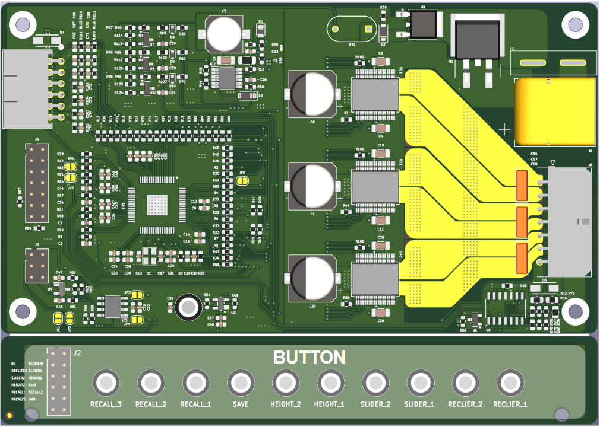
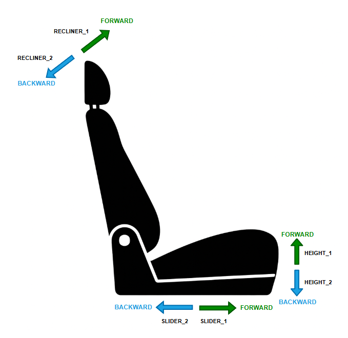
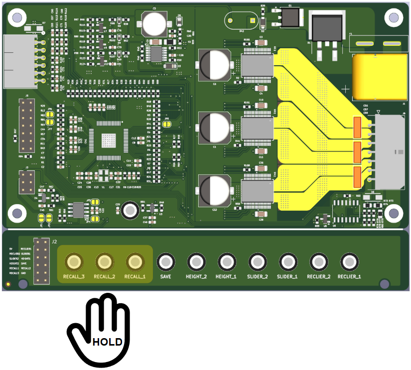
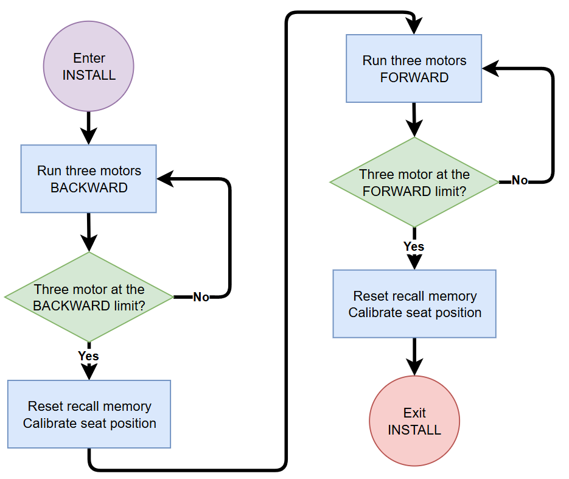
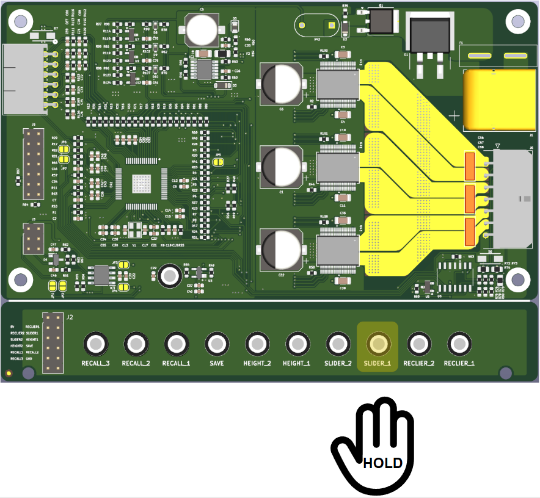
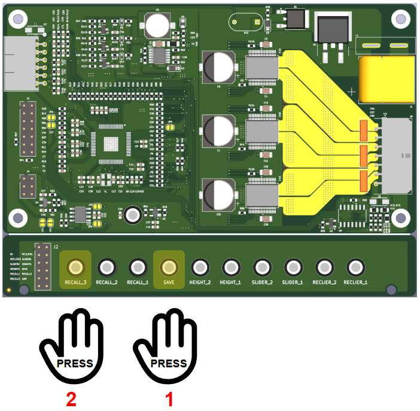
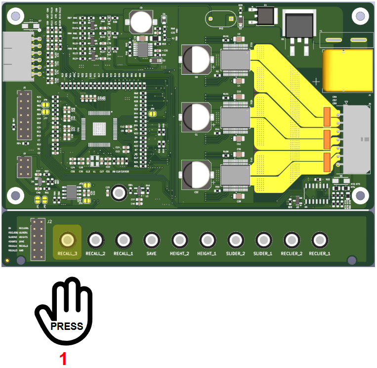

<style>
/* Page numbering styles */
@page {
  @bottom-center {
    content: counter(page);
  }
  margin-left: 2cm;
  margin-right: 2cm;
  margin-top: 2cm;
  margin-bottom: 2cm;
}

/* Footer for page numbers */
.page-number {
  text-align: center;
  font-size: 12px;
  font-style: italic;
  margin-top: 20px;
}

/* Page break styles */
.page-break {
  page-break-after: always;
  break-after: page;
}

/* Table of contents styles */
.toc-entry {
  display: flex;
  justify-content: space-between;
  align-items: baseline;
  width: 100%;
  margin: 2px 0;
}

.toc-title {
  margin-right: 8px;
}

.toc-title-l1 {
  margin-right: 8px;
  font-weight: bold;
  font-size: 1.1em;
}

.toc-dots {
  flex: 1;
  border-bottom: 1px dotted #999;
  margin: 0 8px;
}

.toc-page {
  margin-left: 8px;
}

/* Content justification */
p, li, td, th {
  text-align: justify;
}

/* Section heading styles */
.section-heading {
  font-size: 1em;
}

/* Figure and table caption styles */
.figure-caption, .table-caption {
  text-align: center;
  width: 100%;
  font-style: italic;
  margin-top: 5px;
}

/* Table styles */
.hw-table, .hw-table th, .hw-table td {
  border: 1px solid #222 !important;
  border-collapse: collapse !important;
}
.hw-table th, .hw-table td {
  padding: 4px 6px !important;
  text-align: left;
  font-size: 12px;
}
.hw-table {
  table-layout: fixed !important;
  width: 100% !important;
  margin-bottom: 16px;
}
.hw-table th {
  background: #f2f2f2;
  text-align: center;
}

/* 
   TABLE WIDTH CONTROL SYSTEM:
   - Each table has its own width settings defined directly above it
   - Look for "<!-- TABLE X.Y WIDTH SETTINGS - ADJUST AS NEEDED -->" comments
   - Modify the percentage values to adjust column widths
   - The total should always equal 100%
   - Changes to one table will not affect other tables
*/
</style>

<!-- 
PRINTING INSTRUCTIONS:
When exporting to PDF, use the following settings for proper page numbers:
1. Enable headers and footers
2. Set margins to include space for page numbers
3. Choose "Page numbers at bottom center" option
4. The table of contents page numbers match A4 size with standard margins

TABLE WIDTH INSTRUCTIONS:
To adjust the width of columns in any table:
1. Find the style block directly above the table you want to modify
2. Look for lines like: .table-X-Y th:nth-child(Z) { width: XX%; }
3. Change the XX% values to adjust relative widths (ensure they sum to 100%)
4. The comment at the end of each line indicates what that column contains
-->

<div align="left">
<h3><i><b>Power Car Seat</b></i></h3>
<h1><i><b>Operation Manual</b></i></h2>
</div>


<div align="center">
<h2 class="section-heading"><b>Abstract</b></h2>
</div>

This document provides comprehensive operational instructions for the Panthera car seat control system. It details procedures for operating the system through physical buttons, UART communication, and CAN communication. This manual serves as a reference for users and technicians who need to interact with the system, ensuring proper usage and maximizing functionality.

<div align="center">
<h2 class="section-heading"><b>Revision Note</b></h2>
</div>

<!-- REVISION TABLE WIDTH SETTINGS - ADJUST AS NEEDED -->
<style>
.revision-table th:nth-child(1) { width: 8%; }  /* Version */
.revision-table th:nth-child(2) { width: 12%; } /* Date */
.revision-table th:nth-child(3) { width: 20%; } /* Author */
.revision-table th:nth-child(4) { width: 60%; } /* Description */
</style>

<table class="hw-table revision-table">
<thead>
<tr>
<th>Version</th>
<th>Date</th>
<th>Author</th>
<th>Description of Changes</th>
</tr>
</thead>
<tbody>
<tr><td>v0.0.1</td><td>2025-10-01</td><td>Uy Nguyen Quoc</td><td>Initial document</td></tr>
</tbody>
</table>

<div class="page-break"></div>

<div align="center">
<h2 class="section-heading"><b>Table of Contents</b></h2>
</div>

<div class="toc-entry"><span class="toc-title-l1">1 Introduction</span><span class="toc-dots"></span><span class="toc-page">3</span></div>
<div class="toc-entry"><span class="toc-title-l1">2 Button Operation Instructions</span><span class="toc-dots"></span><span class="toc-page">4</span></div>
<div class="toc-entry"><span class="toc-title">&nbsp;&nbsp;2.1 Overview and Button Functions</span><span class="toc-dots"></span><span class="toc-page">4</span></div>
<div class="toc-entry"><span class="toc-title">&nbsp;&nbsp;2.2 Operation Modes</span><span class="toc-dots"></span><span class="toc-page">6</span></div>
<div class="toc-entry"><span class="toc-title">&nbsp;&nbsp;&nbsp;&nbsp;2.2.1 Installation Mode</span><span class="toc-dots"></span><span class="toc-page">6</span></div>
<div class="toc-entry"><span class="toc-title">&nbsp;&nbsp;&nbsp;&nbsp;2.2.2 Manual Mode (with examples)</span><span class="toc-dots"></span><span class="toc-page">8</span></div>
<div class="toc-entry"><span class="toc-title">&nbsp;&nbsp;&nbsp;&nbsp;2.2.3 Recall Mode (with save and recall examples)</span><span class="toc-dots"></span><span class="toc-page">9</span></div>
<div class="toc-entry"><span class="toc-title">&nbsp;&nbsp;2.3 Safety Features</span><span class="toc-dots"></span><span class="toc-page">12</span></div>
<div class="toc-entry"><span class="toc-title-l1">3 Communication Interface</span><span class="toc-dots"></span><span class="toc-page">13</span></div>
<div class="toc-entry"><span class="toc-title">&nbsp;&nbsp;3.1 UART Communication</span><span class="toc-dots"></span><span class="toc-page">13</span></div>
<div class="toc-entry"><span class="toc-title">&nbsp;&nbsp;&nbsp;&nbsp;3.1.1 Connection Setup</span><span class="toc-dots"></span><span class="toc-page">13</span></div>
<div class="toc-entry"><span class="toc-title">&nbsp;&nbsp;&nbsp;&nbsp;3.1.2 Configure Software</span><span class="toc-dots"></span><span class="toc-page">15</span></div>
<div class="toc-entry"><span class="toc-title">&nbsp;&nbsp;&nbsp;&nbsp;3.1.3 Message Structure</span><span class="toc-dots"></span><span class="toc-page">17</span></div>
<div class="toc-entry"><span class="toc-title">&nbsp;&nbsp;&nbsp;&nbsp;3.1.4 Operation Procedure</span><span class="toc-dots"></span><span class="toc-page">19</span></div>
<div class="toc-entry"><span class="toc-title">&nbsp;&nbsp;3.2 CAN Communication</span><span class="toc-dots"></span><span class="toc-page">22</span></div>
<div class="toc-entry"><span class="toc-title">&nbsp;&nbsp;&nbsp;&nbsp;3.2.1 Connection Setup</span><span class="toc-dots"></span><span class="toc-page">22</span></div>
<div class="toc-entry"><span class="toc-title">&nbsp;&nbsp;&nbsp;&nbsp;3.2.2 Configure Software</span><span class="toc-dots"></span><span class="toc-page">24</span></div>
<div class="toc-entry"><span class="toc-title">&nbsp;&nbsp;&nbsp;&nbsp;3.2.3 Message Structure</span><span class="toc-dots"></span><span class="toc-page">26</span></div>
<div class="toc-entry"><span class="toc-title">&nbsp;&nbsp;&nbsp;&nbsp;3.2.4 Operation Procedure</span><span class="toc-dots"></span><span class="toc-page">28</span></div>
<div class="toc-entry"><span class="toc-title-l1">4 Troubleshooting</span><span class="toc-dots"></span><span class="toc-page">31</span></div>
<div class="toc-entry"><span class="toc-title">&nbsp;&nbsp;4.1 Common Issues</span><span class="toc-dots"></span><span class="toc-page">31</span></div>
<div class="toc-entry"><span class="toc-title">&nbsp;&nbsp;4.2 Diagnostic Procedures</span><span class="toc-dots"></span><span class="toc-page">32</span></div>

<div class="page-break"></div>

<div align="center">
<h2 class="section-heading"><b>List of Figures</b></h2>
</div>

<div class="toc-entry"><span class="toc-title">Figure 2.1: Button Layout of Panthera Seat Control System (Top view)</span><span class="toc-dots"></span><span class="toc-page">4</span></div>
<div class="toc-entry"><span class="toc-title">Figure 2.2: Seat Movement Directions Corresponding to Buttons</span><span class="toc-dots"></span><span class="toc-page">5</span></div>
<div class="toc-entry"><span class="toc-title">Figure 2.3: Activating Installation Mode by Pressing Three RECALL Buttons</span><span class="toc-dots"></span><span class="toc-page">6</span></div>
<div class="toc-entry"><span class="toc-title">Figure 2.4: Installation Sequence Diagram</span><span class="toc-dots"></span><span class="toc-page">7</span></div>
<div class="toc-entry"><span class="toc-title">Figure 2.5: Manual Control Operation Example (Button SLIDER_1)</span><span class="toc-dots"></span><span class="toc-page">8</span></div>
<div class="toc-entry"><span class="toc-title">Figure 2.6: Saving a Seat Position to Memory</span><span class="toc-dots"></span><span class="toc-page">10</span></div>
<div class="toc-entry"><span class="toc-title">Figure 2.7: Recalling a Saved Position Using RECALL Button</span><span class="toc-dots"></span><span class="toc-page">11</span></div>

<div class="page-break"></div>

<div align="center">
<h2 class="section-heading"><b>List of Tables</b></h2>
</div>

<div class="toc-entry"><span class="toc-title">Table 2.1: Button Functions in the Panthera Seat Control System</span><span class="toc-dots"></span><span class="toc-page">5</span></div>
<div class="toc-entry"><span class="toc-title">Table 3.1: UART Connection Parameters</span><span class="toc-dots"></span><span class="toc-page">13</span></div>
<div class="toc-entry"><span class="toc-title">Table 3.2: UART Command Structure Format</span><span class="toc-dots"></span><span class="toc-page">14</span></div>
<div class="toc-entry"><span class="toc-title">Table 3.3: Basic UART Commands</span><span class="toc-dots"></span><span class="toc-page">15</span></div>
<div class="toc-entry"><span class="toc-title">Table 3.4: Advanced UART Commands</span><span class="toc-dots"></span><span class="toc-page">16</span></div>
<div class="toc-entry"><span class="toc-title">Table 3.5: UART Error Codes</span><span class="toc-dots"></span><span class="toc-page">17</span></div>
<div class="toc-entry"><span class="toc-title">Table 4.1: CAN Hardware Configuration Parameters</span><span class="toc-dots"></span><span class="toc-page">18</span></div>
<div class="toc-entry"><span class="toc-title">Table 4.2: CAN Message Format</span><span class="toc-dots"></span><span class="toc-page">19</span></div>
<div class="toc-entry"><span class="toc-title">Table 4.3: CAN Control Commands</span><span class="toc-dots"></span><span class="toc-page">20</span></div>
<div class="toc-entry"><span class="toc-title">Table 4.4: CAN Status Messages</span><span class="toc-dots"></span><span class="toc-page">21</span></div>
<div class="toc-entry"><span class="toc-title">Table 4.5: CAN Diagnostic Functions</span><span class="toc-dots"></span><span class="toc-page">23</span></div>
<div class="toc-entry"><span class="toc-title">Table 5.1: Troubleshooting Common Issues</span><span class="toc-dots"></span><span class="toc-page">24</span></div>

<div class="page-break"></div>

<div align="center">
<h2 class="section-heading"><b>Document Usage Guide</b></h2>
</div>

### **Table Width Adjustment System**

This document uses an independent table width control system that allows easy adjustment of column widths for each individual table. To modify any table's column widths:

1. **Locate the style section** directly above the table you wish to modify
2. **Find the width control lines** that look like this:

```css
.table-X-Y th:nth-child(1) { width: XX%; }  /* Column description */
.table-X-Y th:nth-child(2) { width: XX%; }  /* Column description */
```

3. **Adjust the percentage values** to change relative column widths

Each table has specific width settings that can be modified:

- Values must add up to 100%
- Larger values make columns wider
- Comments at the end of each line describe what that column contains

**Example:**

```html
<!-- TABLE 3.1 WIDTH SETTINGS - ADJUST AS NEEDED -->
<style>
.table-3-1 th:nth-child(1) { width: 25%; }  /* Parameter */
.table-3-1 th:nth-child(2) { width: 25%; }  /* Value */
.table-3-1 th:nth-child(3) { width: 50%; }  /* Description */
</style>
```

Each table has its own independent width controls, so changes to one table won't affect others. This system provides flexibility for formatting throughout the document.

<div class="page-break"></div>

<!-- Keep the original links for navigation within the document -->
<div style="display:none">
- [**1. Introduction**](#1-introduction)
- [**2. Button Operation Instructions**](#2-button-operation-instructions)
  - [**2.1 Overview and Button Functions**](#21-overview-and-button-functions)
  - [**2.2 Operation Modes**](#22-operation-modes)
    - [**2.2.1 Installation Mode**](#221-installation-mode)
    - [**2.2.2 Manual Mode**](#222-manual-mode)
    - [**2.2.3 Recall Mode**](#223-recall-mode)
  - [**2.3 Safety Features**](#23-safety-features)
- [**3. UART Communication Interface**](#3-uart-communication-interface)
  - [**3.1 Connection Setup**](#31-connection-setup)
  - [**3.2 Command Structure**](#32-command-structure)
  - [**3.3 Basic Commands**](#33-basic-commands)
  - [**3.4 Advanced Commands**](#34-advanced-commands)
  - [**3.5 Error Handling**](#35-error-handling)
- [**4. CAN Communication Interface**](#4-can-communication-interface)
  - [**4.1 Hardware Configuration**](#41-hardware-configuration)
  - [**4.2 Message Format**](#42-message-format)
  - [**4.3 Control Commands**](#43-control-commands)
  - [**4.4 Status Monitoring**](#44-status-monitoring)
  - [**4.5 Diagnostic Functions**](#45-diagnostic-functions)
- [**5. Troubleshooting**](#5-troubleshooting)
  - [**5.1 Common Issues**](#51-common-issues)
  - [**5.2 Diagnostic Procedures**](#52-diagnostic-procedures)
- [**Revision Note**](#revision-note)
</div>

## **1. Introduction**

The Panthera Power Car Seat system provides multiple methods of operation to accommodate different use cases and integration scenarios. This manual covers three primary methods of interaction:

1. **Button Operation** - Using the physical control buttons on the seat or control panel
2. **UART Communication** - Interfacing with the system via serial communication 
3. **CAN Communication** - Controlling the system through automotive CAN bus networks

Each method provides complete access to the system's functionality with varying degrees of complexity and integration requirements. This document provides step-by-step instructions for all operational modes to ensure proper system usage.

<div style="page-break-after: always;"></div>

## **2. Button Operation Instructions**

<style>
.hw-table, .hw-table th, .hw-table td {
  border: 1px solid #222 !important;
  border-collapse: collapse !important;
}
.hw-table th, .hw-table td {
  padding: 4px 6px !important;
  text-align: left;
  font-size: 12px;
}
.hw-table {
  table-layout: fixed !important;
  width: 100% !important;
  margin-bottom: 16px;
}
.hw-table th {
  background: #f2f2f2;
  text-align: center;
}
.hw-table th:nth-child(1) { width: 5%; }
.hw-table th:nth-child(2), .hw-table td:nth-child(2) { width: 15%; }
.hw-table th:nth-child(3), .hw-table td:nth-child(3) { width: 40%; }
.hw-table th:nth-child(4), .hw-table td:nth-child(4) { width: 40%; }

/* Page numbering styles */
@page {
  @bottom-center {
    content: counter(page);
  }
}

/* Footer for page numbers */
.page-number {
  text-align: center;
  font-size: 12px;
  font-style: italic;
  margin-top: 20px;
}
</style>

### **2.1 Overview and Button Functions**

The Panthera seat control system features a set of intuitive buttons for controlling various seat positions and memory functions. The buttons are strategically placed for easy access and operation.

<div align="center">
  
  <p class="figure-caption">Figure 2.1: Button Layout of Panthera Seat Control System (Top view)</p>
</div>

The table below provides a comprehensive overview of all buttons, their functions, and associated actions:

<!-- Table 2.1 Width Settings (Adjust values as needed) -->
<style>
.table-2-1 th:nth-child(1) { width: 5%; }
.table-2-1 th:nth-child(2) { width: 25%; }
.table-2-1 th:nth-child(3) { width: 70%; }
</style>

<table class="hw-table table-2-1">
<caption class="table-caption">Table 2.1: Button Functions in the Panthera Seat Control System</caption>
<thead>
<tr>
<th>No.</th>
<th>Button Name</th>
<th>Function</th>
<th>Action</th>
</tr>
</thead>
<tbody>
<tr><td>1</td><td>RECLINER_1</td><td>Seatback Upright Position</td><td>Press and hold to return seatback to upright position. Release to stop movement.</td></tr>
<tr><td>2</td><td>RECLINER_2</td><td>Seatback Recline Position</td><td>Press and hold to recline seatback. Release to stop movement.</td></tr>
<tr><td>3</td><td>SLIDER_1</td><td>Seat Forward Adjustment</td><td>Press and hold to move the seat forward. Release to stop movement.</td></tr>
<tr><td>4</td><td>SLIDER_2</td><td>Seat Backward Adjustment</td><td>Press and hold to move the seat backward. Release to stop movement.</td></tr>
<tr><td>5</td><td>HEIGHT_1</td><td>Seat Upward Movement</td><td>Press and hold to raise the seat. Release to stop movement.</td></tr>
<tr><td>6</td><td>HEIGHT_2</td><td>Seat Downward Movement</td><td>Press and hold to lower the seat. Release to stop movement.</td></tr>
<tr><td>7</td><td>SAVE</td><td>Save Current Position</td><td>Press to begin the position saving sequence.</td></tr>
<tr><td>8</td><td>RECALL_1</td><td>Memory Position 1</td><td>Press and short hold to recall saved position 1 or save current position to memory slot 1.</td></tr>
<tr><td>9</td><td>RECALL_2</td><td>Memory Position 2</td><td>Press and short hold to recall saved position 2 or save current position to memory slot 2.</td></tr>
<tr><td>10</td><td>RECALL_3</td><td>Memory Position 3</td><td>Press and short hold to recall saved position 3 or save current position to memory slot 3.</td></tr>
</tbody>
</table>

<div align="center">
  
  <p class="figure-caption">Figure 2.2: Seat Movement Directions Corresponding to Buttons</p>
</div>

<div style="page-break-after: always;"></div>

### **2.2 Operation Modes**

The Panthera seat control system offers three primary operation modes:

1. **Installation Mode**: Used for initial setup and calibration of seat movement limits.
2. **Manual Mode**: Direct control of seat position using physical buttons.
3. **Recall Mode**: Saving and retrieving customized seat positions from memory.

#### **2.2.1 Installation Mode**

Installation Mode is designed for initial setup and calibration of the seat control system. This mode runs an automatic calibration sequence that establishes the operational limits for all seat axes.

**To Enter Installation Mode:**
1. Press and hold all three RECALL buttons (RECALL_1, RECALL_2, and RECALL_3) simultaneously until all three motors of seat move backward (Approximately 3 seconds)
2. The system will begin the automatic installation sequence

<div align="center">
  
  <p class="figure-caption">Figure 2.3: Activating Installation Mode by Pressing Three RECALL Buttons</p>
</div>

**Installation Sequence:**
1. All three axes of the seat will move backward simultaneously to find their rear limits
2. Upon reaching the backward limits, the system resets the coordinate values for all three recall positions and recognizes this position as the "home" position
3. All three axes then move forward to find their forward limits
4. Upon reaching the forward limits, the system stores these positions as the maximum values for each axis
5. The system returns to IDLE state, ready for normal operation

<div align="center">
  
  <p class="figure-caption">Figure 2.4: Installation Sequence Diagram</p>
</div>

**Note:**
- Do not interrupt the installation process once it begins
- Ensure no obstacles are in the seat's path during calibration
- The entire process takes approximately 60-90 seconds to complete
- After completion, the seat will be ready for normal operation
- This process only needs to be performed once during initial installation or after maintenance

#### **2.2.2 Manual Mode**

Manual Mode is the standard operation mode for direct seat adjustment using the control buttons.

**Manual Mode Operation:**
- Press and hold any movement button (SLIDER_1, SLIDER_2, HEIGHT_1, HEIGHT_2, RECLINER_1, or RECLINER_2)
- The corresponding seat section will move in the indicated direction as long as the button is held
- Multiple buttons can be pressed simultaneously for compound movements
- Release buttons to stop movement

<div align="center">
  
  <p class="figure-caption">Figure 2.5: Manual Control Operation Example (Button SLIDER_1)</p>
</div>

**Example of Manual Operation:**
To adjust the seat to a comfortable driving position:
1. Press and hold SLIDER_1 to move the seat forward
2. Release SLIDER_1 to stop seat at ideal position

**Note:**
- Movement stops immediately when button is released
- System automatically prevents movement beyond mechanical limits

#### **2.2.3 Recall Mode**

Recall Mode allows users to save and retrieve up to three customized seat positions. By default, all three recall position coordinates are initialized to 0, 0, 0, with each axis corresponding to recliner, slider, and height positions respectively.

**Memory Functions:**

The seat position is defined by coordinates along three axes:
- **Recliner axis**: Controls the angle of the seatback
- **Slider axis**: Controls forward/backward position of the entire seat
- **Height axis**: Controls the vertical position of the seat

**To Save a Position:**
1. Adjust the seat to your desired position using Manual Mode (all three axes)
2. Press the SAVE button once
3. Within 0.5 seconds, press one of the RECALL buttons (1, 2, or 3) to store the current position to that memory slot

<div align="center">
  
  <p class="figure-caption">Figure 2.6: Saving a Seat Position to Memory</p>
</div>

**Example of Saving a Position:**
To save your preferred driving position to memory slot 3:
1. Use manual controls to adjust all three axes (recliner, slider, height) to your ideal driving position
2. Press the SAVE button once (system enters save mode)
3. Press RECALL_3 within 0.5 seconds
4. Your preferred driving position is now stored in memory slot 3

**To Recall a Position:**
1. Press the corresponding RECALL button (1, 2, or 3) once
2. The seat will automatically move to the stored position, adjusting all three axes simultaneously
3. When the target position is reached, the system returns to IDLE state

<div align="center">
  
  <p class="figure-caption">Figure 2.7: Recalling a Saved Position Using RECALL Button</p>
</div>

**Example of Using Recall Function:**
To quickly return to your saved driving position after someone else has used the seat:
1. Enter the vehicle and press RECALL_3 once (assuming your position is saved in memory slot 3)
2. The seat will automatically move all three axes simultaneously to your saved position
3. Once the seat reaches the saved position, it will stop automatically and be ready for use

**Note:**
- Each user can have their own preferred positions stored in the three memory slots
- Saved positions are retained even when power is disconnected
- Positions can be overwritten at any time by repeating the save procedure

<div style="page-break-after: always;"></div>

## **3. Communication Interface**

This chapter describes the communication protocols supported by the Panthera Power Car Seat system. The system provides two primary communication interfaces: UART and CAN, each designed for different integration scenarios and use cases.

### **3.1 UART Communication**

UART (Universal Asynchronous Receiver-Transmitter) communication provides a simple serial interface for controlling and monitoring the Panthera system. This interface is ideal for development, testing, and integration with microcontroller-based systems.

#### **3.1.1 Connection Setup**

The UART interface requires a standard 3-wire connection plus ground. Follow these steps for proper hardware setup:

**Hardware Requirements:**
- Host device with UART capability (microcontroller, PC, development board)
- Standard jumper wires or serial cable
- Common ground reference between devices

**Physical Connection:**
1. **Ground Connection**: Connect GND of host device to system ground (Pin GND)
2. **Transmit Line**: Connect TX of host device to RX of Panthera system (Pin RX)
3. **Receive Line**: Connect RX of host device to TX of Panthera system (Pin TX)
4. **Power Supply**: Ensure Panthera system has proper 12V power supply connected

**Connection Parameters:**

<!-- Table 3.1.1 Width Settings -->
<style>
.table-3-1-1 th:nth-child(1) { width: 25%; }  /* Parameter */
.table-3-1-1 th:nth-child(2) { width: 25%; }  /* Value */
.table-3-1-1 th:nth-child(3) { width: 50%; }  /* Description */
</style>

<table class="hw-table table-3-1-1">
<caption class="table-caption">Table 3.1: UART Connection Parameters</caption>
<thead>
<tr>
<th>Parameter</th>
<th>Value</th>
<th>Description</th>
</tr>
</thead>
<tbody>
<tr><td>Baud Rate</td><td>115200 bps</td><td>Communication speed</td></tr>
<tr><td>Data Bits</td><td>8</td><td>Bits per transmission</td></tr>
<tr><td>Stop Bits</td><td>1</td><td>Stop bit configuration</td></tr>
<tr><td>Parity</td><td>None</td><td>No parity bit</td></tr>
<tr><td>Flow Control</td><td>None</td><td>No hardware flow control</td></tr>
<tr><td>Voltage Level</td><td>3.3V TTL</td><td>Logic level standard</td></tr>
</tbody>
</table>

**Connection Verification:**
1. Power on the Panthera system
2. Connect UART interface as described above
3. Open terminal software on host device
4. Send a simple status command to verify communication
5. Verify proper response from the system

#### **3.1.2 Configure Software**

Before establishing communication, configure the host software with the correct parameters and implement proper error handling.

**Terminal Software Configuration:**
For initial testing and development, configure your terminal software:

1. **Serial Port Settings:**
   - Port: Select appropriate COM port (Windows) or /dev/ttyUSB (Linux)
   - Baud Rate: 115200
   - Data Bits: 8
   - Stop Bits: 1
   - Parity: None
   - Flow Control: None

2. **Display Settings:**
   - Enable HEX display mode for command verification
   - Set line ending to none (commands are binary)
   - Enable timestamp for debugging

**Programming Implementation:**
For embedded applications, implement the following software components:

```c
// UART Configuration Structure
typedef struct {
    uint32_t baud_rate;     // 115200
    uint8_t data_bits;      // 8
    uint8_t stop_bits;      // 1
    uint8_t parity;         // 0 (none)
    uint8_t flow_control;   // 0 (none)
} uart_config_t;

// Initialize UART with proper settings
void init_panthera_uart(void) {
    uart_config_t config = {
        .baud_rate = 115200,
        .data_bits = 8,
        .stop_bits = 1,
        .parity = 0,
        .flow_control = 0
    };
    uart_init(UART_PORT, &config);
}
```

**Error Handling Implementation:**
Implement timeout and error checking mechanisms:

```c
// Command timeout (milliseconds)
#define COMMAND_TIMEOUT_MS    1000
#define MAX_RETRIES          3

// Send command with timeout and retry logic
uart_result_t send_panthera_command(uint8_t* cmd, uint8_t len) {
    for (int retry = 0; retry < MAX_RETRIES; retry++) {
        if (uart_send_with_timeout(cmd, len, COMMAND_TIMEOUT_MS) == UART_OK) {
            return UART_SUCCESS;
        }
        delay_ms(100); // Brief delay before retry
    }
    return UART_TIMEOUT;
}
```

#### **3.1.3 Message Structure**

UART commands follow a structured binary format to ensure reliable communication and error detection.

**Command Frame Format:**
```
[START_BYTE][COMMAND_ID][DATA_LENGTH][DATA...][CHECKSUM][END_BYTE]
```

**Field Descriptions:**

<!-- Table 3.1.3 Width Settings -->
<style>
.table-3-1-3 th:nth-child(1) { width: 20%; }  /* Field */
.table-3-1-3 th:nth-child(2) { width: 15%; }  /* Size */
.table-3-1-3 th:nth-child(3) { width: 20%; }  /* Value */
.table-3-1-3 th:nth-child(4) { width: 45%; }  /* Description */
</style>

<table class="hw-table table-3-1-3">
<caption class="table-caption">Table 3.2: UART Message Structure</caption>
<thead>
<tr>
<th>Field</th>
<th>Size (Bytes)</th>
<th>Value</th>
<th>Description</th>
</tr>
</thead>
<tbody>
<tr><td>START_BYTE</td><td>1</td><td>0x55</td><td>Fixed start delimiter for frame synchronization</td></tr>
<tr><td>COMMAND_ID</td><td>1</td><td>0x01-0xFF</td><td>Unique identifier for command type</td></tr>
<tr><td>DATA_LENGTH</td><td>1</td><td>0x00-0xFF</td><td>Number of bytes in DATA field (0-255)</td></tr>
<tr><td>DATA</td><td>0-255</td><td>Variable</td><td>Command-specific parameters and data</td></tr>
<tr><td>CHECKSUM</td><td>1</td><td>Calculated</td><td>8-bit sum of all preceding bytes (modulo 256)</td></tr>
<tr><td>END_BYTE</td><td>1</td><td>0xAA</td><td>Fixed end delimiter for frame validation</td></tr>
</tbody>
</table>

**Checksum Calculation:**
The checksum is calculated as the 8-bit sum of all bytes from START_BYTE to the last DATA byte:

```c
uint8_t calculate_checksum(uint8_t* frame, uint8_t length) {
    uint16_t sum = 0;
    for (uint8_t i = 0; i < length; i++) {
        sum += frame[i];
    }
    return (uint8_t)(sum & 0xFF);
}
```

**Command Categories:**

<!-- Table 3.1.3b Width Settings -->
<style>
.table-3-1-3b th:nth-child(1) { width: 25%; }  /* Category */
.table-3-1-3b th:nth-child(2) { width: 20%; }  /* ID Range */
.table-3-1-3b th:nth-child(3) { width: 55%; }  /* Description */
</style>

<table class="hw-table table-3-1-3b">
<caption class="table-caption">Table 3.3: UART Command Categories</caption>
<thead>
<tr>
<th>Command Category</th>
<th>ID Range</th>
<th>Description</th>
</tr>
</thead>
<tbody>
<tr><td>System Commands</td><td>0x01-0x0F</td><td>General system control and status</td></tr>
<tr><td>Motor Commands</td><td>0x10-0x2F</td><td>Direct motor control and positioning</td></tr>
<tr><td>Memory Commands</td><td>0x30-0x3F</td><td>Position save/recall operations</td></tr>
<tr><td>Diagnostic Commands</td><td>0x40-0x5F</td><td>System diagnostics and monitoring</td></tr>
<tr><td>Configuration Commands</td><td>0x60-0x7F</td><td>Parameter configuration and calibration</td></tr>
<tr><td>Reserved</td><td>0x80-0xEF</td><td>Reserved for future expansion</td></tr>
<tr><td>Error Responses</td><td>0xF0-0xFF</td><td>Error codes and fault indications</td></tr>
</tbody>
</table>

#### **3.1.4 Operation Procedure**

This section provides step-by-step procedures for common UART operations with the Panthera system.

**Step 1: Initialize Communication**
1. Power on system (12V) and wait 3-5 seconds
2. Connect UART cable and open terminal (115200, 8N1)
3. Send status command: `55 01 00 56 AA`
4. Verify response received and valid

**Step 2: Basic Motor Control**
1. **Stop all motors (safety):**
   ```
   Command: 55 03 00 58 AA
   Response: 55 83 00 DB AA
   ```

2. **Check motor positions:**
   ```
   Motor 1: 55 04 01 01 5B AA
   Motor 2: 55 04 01 02 5C AA
   Motor 3: 55 04 01 03 5D AA
   Response: 55 84 02 [POS_LOW] [POS_HIGH] [CHECKSUM] AA
   ```

3. **Move motor (example - Motor 1 forward 50% speed):**
   ```
   Command: 55 02 03 01 01 32 89 AA
   Response: 55 82 00 D7 AA (accepted)
   ```

4. **Stop motor:**
   ```
   Command: 55 02 03 01 00 32 88 AA
   ```

**Step 3: Memory Operations**
1. **Save position:**
   - Position seat manually using motor commands
   - Save to slot: `55 06 01 [SLOT] [CHECKSUM] AA`
   - Example slot 1: `55 06 01 01 5D AA`

2. **Recall position:**
   - Send recall: `55 07 01 [SLOT] [CHECKSUM] AA`
   - Example slot 1: `55 07 01 01 5E AA`
   - Motors move automatically to saved position

**Step 4: Diagnostics**
1. **System status:** `55 10 00 65 AA`
2. **Motor current:** `55 11 01 [MOTOR_ID] [CHECKSUM] AA`
3. **Supply voltage:** `55 12 00 67 AA`

**Step 5: Error Handling**
1. **Communication errors:** Retry up to 3 times with 100ms delay
2. **System errors:** Parse error code from response `55 FF 02 [ERROR_CODE] [CMD] [CHECKSUM] AA`
3. **Reset system:** Software reset `55 01 01 01 58 AA` or power cycle

**Step 6: Complete Example**
```
1. Initialize: 55 01 00 56 AA
2. Move slider: 55 02 03 01 01 4B B6 AA
3. Move height: 55 02 03 02 01 32 89 AA
4. Stop motors: 55 03 00 58 AA
5. Save to slot 2: 55 06 01 02 5E AA
6. Test recall: 55 07 01 02 5F AA
```

### **3.2 CAN Communication**

CAN (Controller Area Network) communication provides a robust, automotive-grade interface for integrating the Panthera system into vehicle networks. This interface supports real-time monitoring, control, and diagnostic functions suitable for production environments.

#### **3.2.1 Connection Setup**

The CAN interface requires proper hardware configuration and termination for reliable operation. Follow these steps for correct CAN bus setup:

**Hardware Requirements:**
- CAN controller/transceiver (built into most automotive ECUs)
- CAN-compatible wiring (twisted pair cable)
- 120Ω termination resistors at both ends of the bus
- Common ground reference between all devices

**Physical Connection:**
1. **CAN High Line**: Connect CAN_H of host to CAN_H of Panthera system (Pin 50)
2. **CAN Low Line**: Connect CAN_L of host to CAN_L of Panthera system (Pin 51)
3. **Ground Reference**: Ensure proper ground connection between devices
4. **Termination**: Install 120Ω resistors at both ends of the CAN bus
5. **Power Supply**: Verify Panthera system has stable 12V power supply

**Bus Configuration Parameters:**

<!-- Table 3.2.1 Width Settings -->
<style>
.table-3-2-1 th:nth-child(1) { width: 25%; }  /* Parameter */
.table-3-2-1 th:nth-child(2) { width: 25%; }  /* Value */
.table-3-2-1 th:nth-child(3) { width: 50%; }  /* Description */
</style>

<table class="hw-table table-3-2-1">
<caption class="table-caption">Table 3.4: CAN Bus Configuration Parameters</caption>
<thead>
<tr>
<th>Parameter</th>
<th>Value</th>
<th>Description</th>
</tr>
</thead>
<tbody>
<tr><td>Baud Rate</td><td>500 kbps</td><td>CAN bus communication speed</td></tr>
<tr><td>Frame Format</td><td>Standard (11-bit)</td><td>CAN identifier format</td></tr>
<tr><td>Termination</td><td>120 Ω</td><td>Required at both ends of CAN bus</td></tr>
<tr><td>Cable Type</td><td>Twisted Pair</td><td>Recommended for noise immunity</td></tr>
<tr><td>Max Bus Length</td><td>40 meters</td><td>Maximum cable length at 500 kbps</td></tr>
<tr><td>Voltage Levels</td><td>ISO 11898</td><td>Standard CAN voltage specification</td></tr>
</tbody>
</table>

**Connection Verification:**
1. Power on all CAN devices on the bus
2. Verify proper termination (60Ω between CAN_H and CAN_L)
3. Check voltage levels (CAN_H ≈ 3.5V, CAN_L ≈ 1.5V when idle)
4. Send test messages to verify communication
5. Monitor for error frames or bus faults

#### **3.2.2 Configure Software**

Proper CAN software configuration is essential for reliable communication. Configure the CAN controller and implement appropriate message handling.

**CAN Controller Configuration:**
Set up the CAN controller with the following parameters:

```c
// CAN Configuration Structure
typedef struct {
    uint32_t baud_rate;      // 500000 (500 kbps)
    uint8_t sample_point;    // 87.5% (recommended)
    uint8_t sjw;            // Synchronization Jump Width: 1
    uint8_t tseg1;          // Time Segment 1: 13
    uint8_t tseg2;          // Time Segment 2: 2
    uint8_t loopback;       // 0 (disabled for normal operation)
    uint8_t silent;         // 0 (disabled for normal operation)
} can_config_t;

// Initialize CAN with Panthera-compatible settings
void init_panthera_can(void) {
    can_config_t config = {
        .baud_rate = 500000,
        .sample_point = 875,    // 87.5%
        .sjw = 1,
        .tseg1 = 13,
        .tseg2 = 2,
        .loopback = 0,
        .silent = 0
    };
    can_init(CAN_CHANNEL, &config);
}
```

**Message Filtering Setup:**
Configure acceptance filters to receive only relevant messages:

```c
// Configure CAN acceptance filters
void setup_panthera_filters(void) {
    // Accept system status messages (0x300-0x3FF)
    can_set_filter(0, 0x300, 0x700, CAN_FILTER_MASK);
    
    // Accept motor status messages (0x310-0x31F)
    can_set_filter(1, 0x310, 0x7F0, CAN_FILTER_MASK);
    
    // Accept diagnostic responses (0x7E8)
    can_set_filter(2, 0x7E8, 0x7FF, CAN_FILTER_EXACT);
}
```

**Transmission Queue Management:**
Implement proper message prioritization and queue management:

```c
// CAN message priority levels
typedef enum {
    CAN_PRIORITY_HIGH = 0,      // Emergency stop, safety commands
    CAN_PRIORITY_NORMAL = 1,    // Regular control commands
    CAN_PRIORITY_LOW = 2        // Status requests, diagnostics
} can_priority_t;

// Send CAN message with priority handling
can_result_t send_panthera_can_msg(uint32_t id, uint8_t* data, uint8_t len, can_priority_t priority) {
    can_message_t msg = {
        .id = id,
        .length = len,
        .priority = priority,
        .timestamp = get_system_time()
    };
    memcpy(msg.data, data, len);
    
    return can_transmit_message(&msg);
}
```

#### **3.2.3 Message Structure**

CAN messages use specific identifiers and data formats to organize communication between the host and Panthera system.

**Message ID Allocation:**

<!-- Table 3.2.3 Width Settings -->
<style>
.table-3-2-3 th:nth-child(1) { width: 25%; }  /* Message Type */
.table-3-2-3 th:nth-child(2) { width: 20%; }  /* CAN ID (hex) */
.table-3-2-3 th:nth-child(3) { width: 15%; }  /* Direction */
.table-3-2-3 th:nth-child(4) { width: 40%; }  /* Description */
</style>

<table class="hw-table table-3-2-3">
<caption class="table-caption">Table 3.5: CAN Message ID Allocation</caption>
<thead>
<tr>
<th>Message Type</th>
<th>CAN ID (hex)</th>
<th>Direction</th>
<th>Description</th>
</tr>
</thead>
<tbody>
<tr><td>System Commands</td><td>0x200</td><td>Host → Panthera</td><td>General system control commands</td></tr>
<tr><td>Motor 1 Commands</td><td>0x210</td><td>Host → Panthera</td><td>Slider motor control commands</td></tr>
<tr><td>Motor 2 Commands</td><td>0x211</td><td>Host → Panthera</td><td>Height motor control commands</td></tr>
<tr><td>Motor 3 Commands</td><td>0x212</td><td>Host → Panthera</td><td>Recliner motor control commands</td></tr>
<tr><td>System Status</td><td>0x300</td><td>Panthera → Host</td><td>General system status information</td></tr>
<tr><td>Motor 1 Status</td><td>0x310</td><td>Panthera → Host</td><td>Slider motor status and position</td></tr>
<tr><td>Motor 2 Status</td><td>0x311</td><td>Panthera → Host</td><td>Height motor status and position</td></tr>
<tr><td>Motor 3 Status</td><td>0x312</td><td>Panthera → Host</td><td>Recliner motor status and position</td></tr>
<tr><td>Diagnostic Request</td><td>0x7DF</td><td>Host → Panthera</td><td>ISO 14229 diagnostic services</td></tr>
<tr><td>Diagnostic Response</td><td>0x7E8</td><td>Panthera → Host</td><td>ISO 14229 diagnostic responses</td></tr>
</tbody>
</table>

**Command Message Format:**
All command messages follow this 8-byte data structure:

<!-- Table 3.2.3b Width Settings -->
<style>
.table-3-2-3b th:nth-child(1) { width: 15%; }  /* Byte Position */
.table-3-2-3b th:nth-child(2) { width: 25%; }  /* Field Name */
.table-3-2-3b th:nth-child(3) { width: 60%; }  /* Description */
</style>

<table class="hw-table table-3-2-3b">
<caption class="table-caption">Table 3.6: CAN Command Message Structure</caption>
<thead>
<tr>
<th>Byte Position</th>
<th>Field Name</th>
<th>Description</th>
</tr>
</thead>
<tbody>
<tr><td>0</td><td>Command Type</td><td>Specific command identifier (0x01-0xFF)</td></tr>
<tr><td>1</td><td>Parameter 1</td><td>First command parameter or motor ID</td></tr>
<tr><td>2-3</td><td>Parameter 2</td><td>16-bit value (position, speed, etc.)</td></tr>
<tr><td>4-5</td><td>Parameter 3</td><td>Additional 16-bit parameter if needed</td></tr>
<tr><td>6</td><td>Flags</td><td>Command flags and options</td></tr>
<tr><td>7</td><td>Sequence</td><td>Message sequence number for tracking</td></tr>
</tbody>
</table>

**Status Message Format:**
Status messages provide real-time feedback from the Panthera system:

<!-- Table 3.2.3c Width Settings -->
<style>
.table-3-2-3c th:nth-child(1) { width: 15%; }  /* Byte Position */
.table-3-2-3c th:nth-child(2) { width: 25%; }  /* Field Name */
.table-3-2-3c th:nth-child(3) { width: 60%; }  /* Description */
</style>

<table class="hw-table table-3-2-3c">
<caption class="table-caption">Table 3.7: CAN Status Message Structure</caption>
<thead>
<tr>
<th>Byte Position</th>
<th>Field Name</th>
<th>Description</th>
</tr>
</thead>
<tbody>
<tr><td>0</td><td>Status Flags</td><td>System status and error flags</td></tr>
<tr><td>1</td><td>Motor State</td><td>Current motor operational state</td></tr>
<tr><td>2-3</td><td>Current Position</td><td>16-bit current position value</td></tr>
<tr><td>4-5</td><td>Current/Voltage</td><td>Motor current (mA) or supply voltage (mV)</td></tr>
<tr><td>6</td><td>Temperature</td><td>System temperature (°C + 40 offset)</td></tr>
<tr><td>7</td><td>Sequence</td><td>Message sequence number</td></tr>
</tbody>
</table>

#### **3.2.4 Operation Procedure**

This section provides detailed procedures for implementing CAN-based control and monitoring of the Panthera system.

**System Initialization Procedure:**
1. **Configure CAN Controller:**
   ```c
   // Step 1: Initialize CAN hardware
   init_panthera_can();
   setup_panthera_filters();
   can_enable_interrupts();
   ```

2. **Verify System Connectivity:**
   ```c
   // Step 2: Send system status request
   uint8_t status_req[8] = {0x01, 0x00, 0x00, 0x00, 0x00, 0x00, 0x00, 0x00};
   send_panthera_can_msg(0x200, status_req, 8, CAN_PRIORITY_NORMAL);
   
   // Step 3: Wait for response within timeout period
   if (wait_for_can_response(0x300, 1000) == CAN_SUCCESS) {
       // System is responding properly
   }
   ```

**Motor Control Procedure:**
1. **Safety Check:**
   ```c
   // Always verify system is in safe state before motor commands
   if (get_system_status() & SYSTEM_FAULT_MASK) {
       // Handle fault condition before proceeding
       clear_system_faults();
   }
   ```

2. **Send Motor Command:**
   ```c
   // Example: Move slider motor (Motor 1) forward at 75% speed
   uint8_t motor_cmd[8] = {
       0x02,           // Command: Move with speed
       0x01,           // Direction: Forward
       0x4B, 0x00,     // Speed: 75% (0x004B = 75)
       0x00, 0x00,     // Reserved
       0x00,           // Flags
       get_sequence()  // Sequence number
   };
   send_panthera_can_msg(0x210, motor_cmd, 8, CAN_PRIORITY_NORMAL);
   ```

3. **Monitor Operation:**
   ```c
   // Continuously monitor motor status during operation
   while (motor_is_moving()) {
       can_message_t status_msg;
       if (receive_can_message(0x310, &status_msg, 100) == CAN_SUCCESS) {
           process_motor_status(&status_msg);
       }
       delay_ms(50); // Status update rate
   }
   ```

**Diagnostic Procedure:**
1. **Request System Information:**
   ```c
   // ISO 14229 diagnostic request format
   uint8_t diag_req[8] = {
       0x02,           // Length
       0x09,           // Service: Request Vehicle Information
       0x05,           // PID: System Information
       0x00, 0x00, 0x00, 0x00, 0x00
   };
   send_panthera_can_msg(0x7DF, diag_req, 8, CAN_PRIORITY_LOW);
   ```

2. **Process Diagnostic Response:**
   ```c
   can_message_t diag_resp;
   if (receive_can_message(0x7E8, &diag_resp, 1000) == CAN_SUCCESS) {
       if (diag_resp.data[1] == 0x49) { // Positive response
           // Process system information data
           process_system_info(&diag_resp.data[3]);
       }
   }
   ```

**Error Handling and Recovery:**
1. **Detect Communication Errors:**
   ```c
   // Monitor CAN bus errors
   if (can_get_error_count() > ERROR_THRESHOLD) {
       // Implement bus error recovery
       can_reset_controller();
       init_panthera_can();
   }
   ```

2. **Handle System Faults:**
   ```c
   // Process fault messages from Panthera system
   void handle_panthera_fault(can_message_t* msg) {
       uint8_t fault_code = msg->data[0];
       uint8_t motor_id = msg->data[1];
       
       switch (fault_code) {
           case MOTOR_OVERCURRENT:
               stop_motor(motor_id);
               log_fault("Motor overcurrent", motor_id);
               break;
           case POSITION_ERROR:
               recalibrate_motor(motor_id);
               break;
           // Handle other fault conditions
       }
   }
   ```

**Periodic Status Monitoring:**
```c
// Implement periodic status monitoring
void panthera_periodic_task(void) {
    static uint32_t last_status_time = 0;
    uint32_t current_time = get_system_time();
    
    // Request status every 100ms
    if (current_time - last_status_time >= 100) {
        request_all_motor_status();
        last_status_time = current_time;
    }
    
    // Process any received status messages
    process_received_can_messages();
}
```

<div style="page-break-after: always;"></div>

## **4. Troubleshooting**

### **4.1 Common Issues**

<!-- TABLE 4.1 WIDTH SETTINGS - ADJUST AS NEEDED -->
<style>
.table-4-1 th:nth-child(1) { width: 25%; }  /* Issue */
.table-4-1 th:nth-child(2) { width: 25%; }  /* Possible Causes */
.table-4-1 th:nth-child(3) { width: 50%; }  /* Troubleshooting Steps */
</style>

<table class="hw-table table-4-1">
<caption class="table-caption">Table 4.1: Troubleshooting Common Issues</caption>
<thead>
<tr>
<th>Issue</th>
<th>Possible Causes</th>
<th>Troubleshooting Steps</th>
</tr>
</thead>
<tbody>
<tr><td>No movement when buttons pressed</td><td>- Power supply issue<br>- System in FAULT state<br>- Button connection problem</td><td>1. Check power supply voltage<br>2. Verify system status via UART/CAN<br>3. Check button connections<br>4. Reset system if in fault state</td></tr>
<tr><td>Intermittent operation</td><td>- Loose connections<br>- Thermal protection active<br>- Current limiting</td><td>1. Check all electrical connections<br>2. Allow system to cool down<br>3. Check for obstructions<br>4. Verify voltage levels</td></tr>
<tr><td>No response to UART commands</td><td>- Incorrect baud rate<br>- TX/RX reversed<br>- Command format error</td><td>1. Verify baud rate settings<br>2. Check TX/RX connections<br>3. Verify command structure and checksum<br>4. Check power and ground connections</td></tr>
<tr><td>No response to CAN commands</td><td>- Incorrect baud rate<br>- Missing termination<br>- Incorrect message ID</td><td>1. Verify CAN bus configuration<br>2. Check termination resistors<br>3. Verify message IDs<br>4. Check physical connections</td></tr>
<tr><td>Memory positions not working</td><td>- Positions not saved<br>- Memory corruption<br>- Sensor failure</td><td>1. Re-save positions<br>2. Reset system<br>3. Check hall sensors<br>4. Verify motor operation</td></tr>
</tbody>
</table>

### **4.2 Diagnostic Procedures**

**System Reset Procedure:**
1. Disconnect power for at least 10 seconds
2. Reconnect power
3. Allow system to initialize (approximately 5 seconds)
4. Test basic functionality

**Button Test Procedure:**
1. Enter diagnostic mode via UART command 0xD0
2. Press each button one at a time
3. System will report button status via UART
4. Exit diagnostic mode with command 0xD1

**Motor Test Procedure:**
1. Connect to system via UART or CAN
2. Issue motor movement commands at reduced speed (25%)
3. Verify smooth operation in both directions
4. Check current consumption during operation
5. Verify position reporting accuracy

**Communication Test Procedure:**
1. Send basic status request commands
2. Verify response format and data
3. Check for communication timeouts or errors
4. Test at various baud rates if issues persist


<!-- Note: When printing this document to PDF, page numbers will automatically appear at the bottom of each page -->
<div class="page-number"></div>
