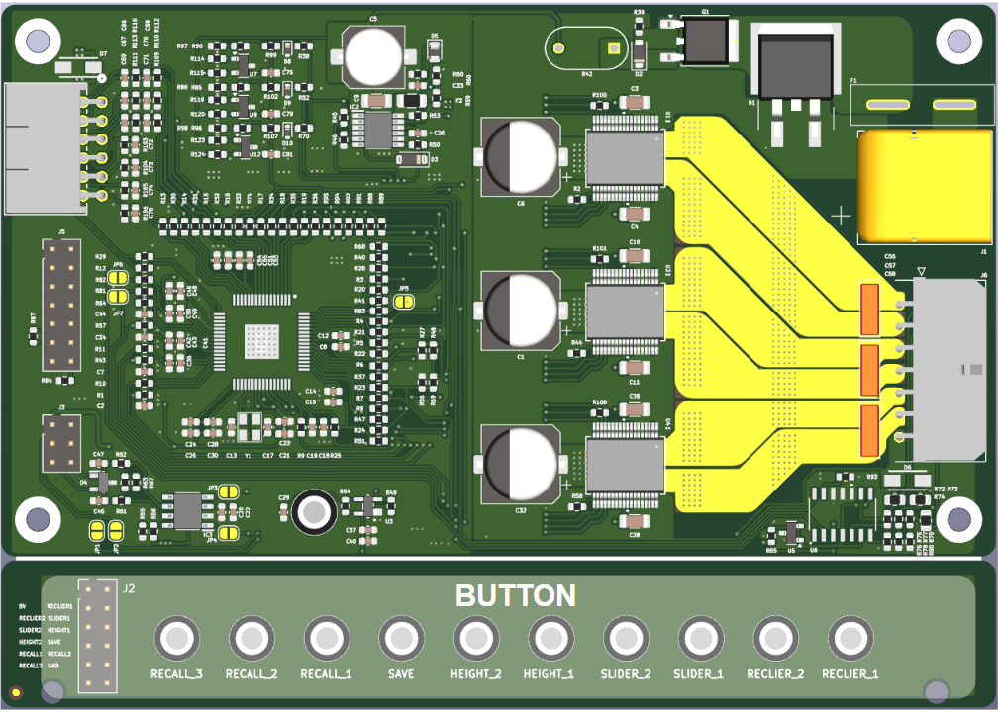
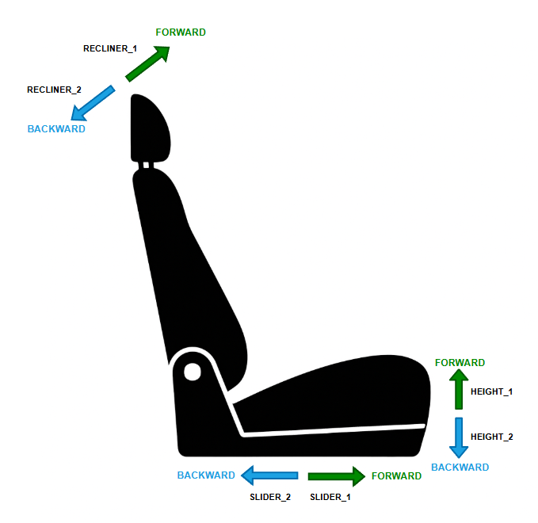
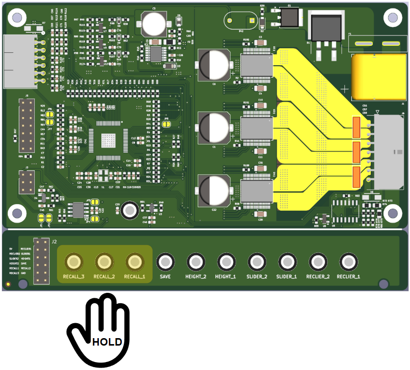
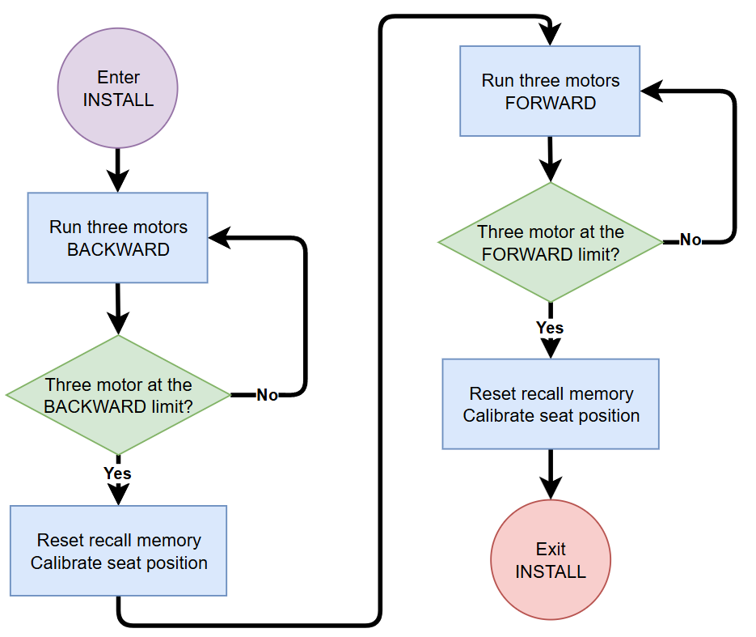
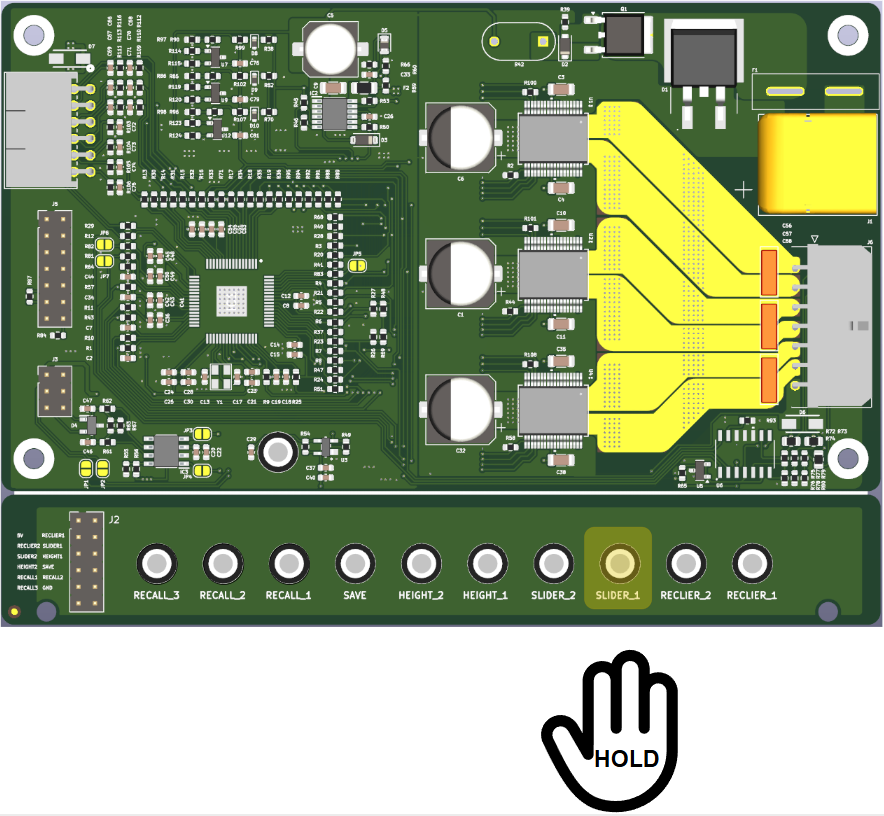
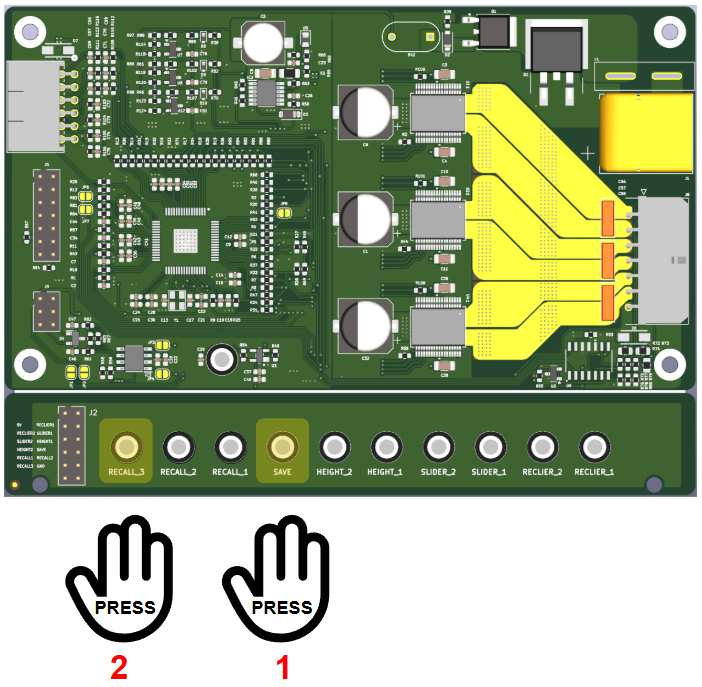
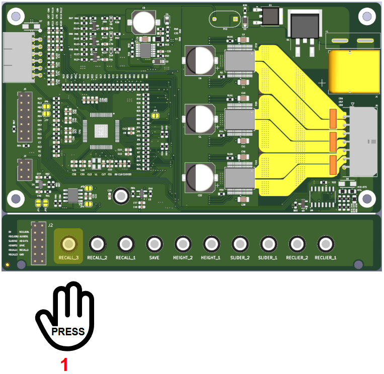

<style>
/* Page numbering styles */
@page {
  @bottom-center {
    content: counter(page);
  }
  margin-left: 2cm;
  margin-right: 2cm;
  margin-top: 2cm;
  margin-bottom: 2cm;
}

/* Footer for page numbers */
.page-number {
  text-align: center;
  font-size: 12px;
  font-style: italic;
  margin-top: 20px;
}

/* Page break styles */
.page-break {
  page-break-after: always;
  break-after: page;
}

/* Table of contents styles */
.toc-entry {
  display: flex;
  justify-content: space-between;
  align-items: baseline;
  width: 100%;
  margin: 2px 0;
}

.toc-title {
  margin-right: 8px;
}

.toc-title-l1 {
  margin-right: 8px;
  font-weight: bold;
  font-size: 1.1em;
}

.toc-dots {
  flex: 1;
  border-bottom: 1px dotted #999;
  margin: 0 8px;
}

.toc-page {
  margin-left: 8px;
}

/* Content justification */
p, li, td, th {
  text-align: justify;
}

/* Section heading styles */
.section-heading {
  font-size: 1em;
}

/* Figure and table caption styles */
.figure-caption, .table-caption {
  text-align: center;
  width: 100%;
  font-style: italic;
  margin-top: 5px;
}

/* Table styles */
.hw-table, .hw-table th, .hw-table td {
  border: 1px solid #222 !important;
  border-collapse: collapse !important;
}
.hw-table th, .hw-table td {
  padding: 4px 6px !important;
  text-align: left;
  font-size: 12px;
}
.hw-table {
  table-layout: fixed !important;
  width: 100% !important;
  margin-bottom: 16px;
}
.hw-table th {
  background: #f2f2f2;
  text-align: center;
}

/* 
   TABLE WIDTH CONTROL SYSTEM:
   - Each table has its own width settings defined directly above it
   - Look for "<!-- TABLE X.Y WIDTH SETTINGS - ADJUST AS NEEDED -->" comments
   - Modify the percentage values to adjust column widths
   - The total should always equal 100%
   - Changes to one table will not affect other tables
*/
</style>

<!-- 
PRINTING INSTRUCTIONS:
When exporting to PDF, use the following settings for proper page numbers:
1. Enable headers and footers
2. Set margins to include space for page numbers
3. Choose "Page numbers at bottom center" option
4. The table of contents page numbers match A4 size with standard margins

TABLE WIDTH INSTRUCTIONS:
To adjust the width of columns in any table:
1. Find the style block directly above the table you want to modify
2. Look for lines like: .table-X-Y th:nth-child(Z) { width: XX%; }
3. Change the XX% values to adjust relative widths (ensure they sum to 100%)
4. The comment at the end of each line indicates what that column contains
-->

<div align="left">
<h3><i><b>Power Car Seat</b></i></h3>
<h1><i><b>Operation Manual</b></i></h2>
</div>


<div align="center">
<h2 class="section-heading"><b>Abstract</b></h2>
</div>

This document provides comprehensive operational instructions for the Panthera car seat control system. It details procedures for operating the system through physical buttons, UART communication, and CAN communication. This manual serves as a reference for users and technicians who need to interact with the system, ensuring proper usage and maximizing functionality.

<div align="center">
<h2 class="section-heading"><b>Revision Note</b></h2>
</div>

<!-- REVISION TABLE WIDTH SETTINGS - ADJUST AS NEEDED -->
<style>
.revision-table th:nth-child(1) { width: 8%; }  /* Version */
.revision-table th:nth-child(2) { width: 12%; } /* Date */
.revision-table th:nth-child(3) { width: 20%; } /* Author */
.revision-table th:nth-child(4) { width: 60%; } /* Description */
</style>

<table class="hw-table revision-table">
<thead>
<tr>
<th>Version</th>
<th>Date</th>
<th>Author</th>
<th>Description of Changes</th>
</tr>
</thead>
<tbody>
<tr><td>v0.0.1</td><td>2025-10-01</td><td>Uy Nguyen Quoc</td><td>Initial document</td></tr>
</tbody>
</table>

<div class="page-break"></div>

<div align="center">
<h2 class="section-heading"><b>Table of Contents</b></h2>
</div>

<div class="toc-entry"><span class="toc-title-l1">1 Introduction</span><span class="toc-dots"></span><span class="toc-page">3</span></div>
<div class="toc-entry"><span class="toc-title-l1">2 Button Operation Instructions</span><span class="toc-dots"></span><span class="toc-page">4</span></div>
<div class="toc-entry"><span class="toc-title">&nbsp;&nbsp;2.1 Overview and Button Functions</span><span class="toc-dots"></span><span class="toc-page">4</span></div>
<div class="toc-entry"><span class="toc-title">&nbsp;&nbsp;2.2 Operation Modes</span><span class="toc-dots"></span><span class="toc-page">6</span></div>
<div class="toc-entry"><span class="toc-title">&nbsp;&nbsp;&nbsp;&nbsp;2.2.1 Installation Mode</span><span class="toc-dots"></span><span class="toc-page">6</span></div>
<div class="toc-entry"><span class="toc-title">&nbsp;&nbsp;&nbsp;&nbsp;2.2.2 Manual Mode (with examples)</span><span class="toc-dots"></span><span class="toc-page">8</span></div>
<div class="toc-entry"><span class="toc-title">&nbsp;&nbsp;&nbsp;&nbsp;2.2.3 Recall Mode (with save and recall examples)</span><span class="toc-dots"></span><span class="toc-page">9</span></div>
<div class="toc-entry"><span class="toc-title">&nbsp;&nbsp;2.3 Safety Features</span><span class="toc-dots"></span><span class="toc-page">12</span></div>
<div class="toc-entry"><span class="toc-title-l1">3 UART Communication Interface</span><span class="toc-dots"></span><span class="toc-page">13</span></div>
<div class="toc-entry"><span class="toc-title">&nbsp;&nbsp;3.1 Connection Setup</span><span class="toc-dots"></span><span class="toc-page">13</span></div>
<div class="toc-entry"><span class="toc-title">&nbsp;&nbsp;3.2 Command Structure</span><span class="toc-dots"></span><span class="toc-page">14</span></div>
<div class="toc-entry"><span class="toc-title">&nbsp;&nbsp;3.3 Basic Commands</span><span class="toc-dots"></span><span class="toc-page">15</span></div>
<div class="toc-entry"><span class="toc-title">&nbsp;&nbsp;3.4 Advanced Commands</span><span class="toc-dots"></span><span class="toc-page">16</span></div>
<div class="toc-entry"><span class="toc-title">&nbsp;&nbsp;3.5 Error Handling</span><span class="toc-dots"></span><span class="toc-page">17</span></div>
<div class="toc-entry"><span class="toc-title-l1">4 CAN Communication Interface</span><span class="toc-dots"></span><span class="toc-page">18</span></div>
<div class="toc-entry"><span class="toc-title">&nbsp;&nbsp;4.1 Hardware Configuration</span><span class="toc-dots"></span><span class="toc-page">18</span></div>
<div class="toc-entry"><span class="toc-title">&nbsp;&nbsp;4.2 Message Format</span><span class="toc-dots"></span><span class="toc-page">19</span></div>
<div class="toc-entry"><span class="toc-title">&nbsp;&nbsp;4.3 Control Commands</span><span class="toc-dots"></span><span class="toc-page">20</span></div>
<div class="toc-entry"><span class="toc-title">&nbsp;&nbsp;4.4 Status Monitoring</span><span class="toc-dots"></span><span class="toc-page">21</span></div>
<div class="toc-entry"><span class="toc-title">&nbsp;&nbsp;4.5 Diagnostic Functions</span><span class="toc-dots"></span><span class="toc-page">22</span></div>
<div class="toc-entry"><span class="toc-title-l1">5 Troubleshooting</span><span class="toc-dots"></span><span class="toc-page">24</span></div>
<div class="toc-entry"><span class="toc-title">&nbsp;&nbsp;5.1 Common Issues</span><span class="toc-dots"></span><span class="toc-page">24</span></div>
<div class="toc-entry"><span class="toc-title">&nbsp;&nbsp;5.2 Diagnostic Procedures</span><span class="toc-dots"></span><span class="toc-page">25</span></div>

<div class="page-break"></div>

<div align="center">
<h2 class="section-heading"><b>List of Figures</b></h2>
</div>

<div class="toc-entry"><span class="toc-title">Figure 2.1: Button Layout of Panthera Seat Control System (Top view)</span><span class="toc-dots"></span><span class="toc-page">4</span></div>
<div class="toc-entry"><span class="toc-title">Figure 2.2: Seat Movement Directions Corresponding to Buttons</span><span class="toc-dots"></span><span class="toc-page">5</span></div>
<div class="toc-entry"><span class="toc-title">Figure 2.3: Activating Installation Mode by Pressing Three RECALL Buttons</span><span class="toc-dots"></span><span class="toc-page">6</span></div>
<div class="toc-entry"><span class="toc-title">Figure 2.4: Installation Sequence Diagram</span><span class="toc-dots"></span><span class="toc-page">7</span></div>
<div class="toc-entry"><span class="toc-title">Figure 2.5: Manual Control Operation Example (Button SLIDER_1)</span><span class="toc-dots"></span><span class="toc-page">8</span></div>
<div class="toc-entry"><span class="toc-title">Figure 2.6: Saving a Seat Position to Memory</span><span class="toc-dots"></span><span class="toc-page">10</span></div>
<div class="toc-entry"><span class="toc-title">Figure 2.7: Recalling a Saved Position Using RECALL Button</span><span class="toc-dots"></span><span class="toc-page">11</span></div>

<div class="page-break"></div>

<div align="center">
<h2 class="section-heading"><b>List of Tables</b></h2>
</div>

<div class="toc-entry"><span class="toc-title">Table 2.1: Button Functions in the Panthera Seat Control System</span><span class="toc-dots"></span><span class="toc-page">5</span></div>
<div class="toc-entry"><span class="toc-title">Table 3.1: UART Connection Parameters</span><span class="toc-dots"></span><span class="toc-page">13</span></div>
<div class="toc-entry"><span class="toc-title">Table 3.2: UART Command Structure Format</span><span class="toc-dots"></span><span class="toc-page">14</span></div>
<div class="toc-entry"><span class="toc-title">Table 3.3: Basic UART Commands</span><span class="toc-dots"></span><span class="toc-page">15</span></div>
<div class="toc-entry"><span class="toc-title">Table 3.4: Advanced UART Commands</span><span class="toc-dots"></span><span class="toc-page">16</span></div>
<div class="toc-entry"><span class="toc-title">Table 3.5: UART Error Codes</span><span class="toc-dots"></span><span class="toc-page">17</span></div>
<div class="toc-entry"><span class="toc-title">Table 4.1: CAN Hardware Configuration Parameters</span><span class="toc-dots"></span><span class="toc-page">18</span></div>
<div class="toc-entry"><span class="toc-title">Table 4.2: CAN Message Format</span><span class="toc-dots"></span><span class="toc-page">19</span></div>
<div class="toc-entry"><span class="toc-title">Table 4.3: CAN Control Commands</span><span class="toc-dots"></span><span class="toc-page">20</span></div>
<div class="toc-entry"><span class="toc-title">Table 4.4: CAN Status Messages</span><span class="toc-dots"></span><span class="toc-page">21</span></div>
<div class="toc-entry"><span class="toc-title">Table 4.5: CAN Diagnostic Functions</span><span class="toc-dots"></span><span class="toc-page">23</span></div>
<div class="toc-entry"><span class="toc-title">Table 5.1: Troubleshooting Common Issues</span><span class="toc-dots"></span><span class="toc-page">24</span></div>

<div class="page-break"></div>

<div align="center">
<h2 class="section-heading"><b>Document Usage Guide</b></h2>
</div>

### **Table Width Adjustment System**

This document uses an independent table width control system that allows easy adjustment of column widths for each individual table. To modify any table's column widths:

1. **Locate the style section** directly above the table you wish to modify
2. **Find the width control lines** that look like this:

```css
.table-X-Y th:nth-child(1) { width: XX%; }  /* Column description */
.table-X-Y th:nth-child(2) { width: XX%; }  /* Column description */
```

3. **Adjust the percentage values** to change relative column widths

Each table has specific width settings that can be modified:

- Values must add up to 100%
- Larger values make columns wider
- Comments at the end of each line describe what that column contains

**Example:**

```html
<!-- TABLE 3.1 WIDTH SETTINGS - ADJUST AS NEEDED -->
<style>
.table-3-1 th:nth-child(1) { width: 25%; }  /* Parameter */
.table-3-1 th:nth-child(2) { width: 25%; }  /* Value */
.table-3-1 th:nth-child(3) { width: 50%; }  /* Description */
</style>
```

Each table has its own independent width controls, so changes to one table won't affect others. This system provides flexibility for formatting throughout the document.

<div class="page-break"></div>

<!-- Keep the original links for navigation within the document -->
<div style="display:none">
- [**1. Introduction**](#1-introduction)
- [**2. Button Operation Instructions**](#2-button-operation-instructions)
  - [**2.1 Overview and Button Functions**](#21-overview-and-button-functions)
  - [**2.2 Operation Modes**](#22-operation-modes)
    - [**2.2.1 Installation Mode**](#221-installation-mode)
    - [**2.2.2 Manual Mode**](#222-manual-mode)
    - [**2.2.3 Recall Mode**](#223-recall-mode)
  - [**2.3 Safety Features**](#23-safety-features)
- [**3. UART Communication Interface**](#3-uart-communication-interface)
  - [**3.1 Connection Setup**](#31-connection-setup)
  - [**3.2 Command Structure**](#32-command-structure)
  - [**3.3 Basic Commands**](#33-basic-commands)
  - [**3.4 Advanced Commands**](#34-advanced-commands)
  - [**3.5 Error Handling**](#35-error-handling)
- [**4. CAN Communication Interface**](#4-can-communication-interface)
  - [**4.1 Hardware Configuration**](#41-hardware-configuration)
  - [**4.2 Message Format**](#42-message-format)
  - [**4.3 Control Commands**](#43-control-commands)
  - [**4.4 Status Monitoring**](#44-status-monitoring)
  - [**4.5 Diagnostic Functions**](#45-diagnostic-functions)
- [**5. Troubleshooting**](#5-troubleshooting)
  - [**5.1 Common Issues**](#51-common-issues)
  - [**5.2 Diagnostic Procedures**](#52-diagnostic-procedures)
- [**Revision Note**](#revision-note)
</div>

## **1. Introduction**

The Panthera Power Car Seat system provides multiple methods of operation to accommodate different use cases and integration scenarios. This manual covers three primary methods of interaction:

1. **Button Operation** - Using the physical control buttons on the seat or control panel
2. **UART Communication** - Interfacing with the system via serial communication 
3. **CAN Communication** - Controlling the system through automotive CAN bus networks

Each method provides complete access to the system's functionality with varying degrees of complexity and integration requirements. This document provides step-by-step instructions for all operational modes to ensure proper system usage.

<div style="page-break-after: always;"></div>

## **2. Button Operation Instructions**

<style>
.hw-table, .hw-table th, .hw-table td {
  border: 1px solid #222 !important;
  border-collapse: collapse !important;
}
.hw-table th, .hw-table td {
  padding: 4px 6px !important;
  text-align: left;
  font-size: 12px;
}
.hw-table {
  table-layout: fixed !important;
  width: 100% !important;
  margin-bottom: 16px;
}
.hw-table th {
  background: #f2f2f2;
  text-align: center;
}
.hw-table th:nth-child(1) { width: 5%; }
.hw-table th:nth-child(2), .hw-table td:nth-child(2) { width: 15%; }
.hw-table th:nth-child(3), .hw-table td:nth-child(3) { width: 40%; }
.hw-table th:nth-child(4), .hw-table td:nth-child(4) { width: 40%; }

/* Page numbering styles */
@page {
  @bottom-center {
    content: counter(page);
  }
}

/* Footer for page numbers */
.page-number {
  text-align: center;
  font-size: 12px;
  font-style: italic;
  margin-top: 20px;
}
</style>

### **2.1 Overview and Button Functions**

The Panthera seat control system features a set of intuitive buttons for controlling various seat positions and memory functions. The buttons are strategically placed for easy access and operation.

<div align="center">
  
  <p class="figure-caption">Figure 2.1: Button Layout of Panthera Seat Control System (Top view)</p>
</div>

The table below provides a comprehensive overview of all buttons, their functions, and associated actions:

<!-- Table 2.1 Width Settings (Adjust values as needed) -->
<style>
.table-2-1 th:nth-child(1) { width: 5%; }
.table-2-1 th:nth-child(2) { width: 25%; }
.table-2-1 th:nth-child(3) { width: 70%; }
</style>

<table class="hw-table table-2-1">
<caption class="table-caption">Table 2.1: Button Functions in the Panthera Seat Control System</caption>
<thead>
<tr>
<th>No.</th>
<th>Button Name</th>
<th>Function</th>
<th>Action</th>
</tr>
</thead>
<tbody>
<tr><td>1</td><td>RECLINER_1</td><td>Seatback Upright Position</td><td>Press and hold to return seatback to upright position. Release to stop movement.</td></tr>
<tr><td>2</td><td>RECLINER_2</td><td>Seatback Recline Position</td><td>Press and hold to recline seatback. Release to stop movement.</td></tr>
<tr><td>3</td><td>SLIDER_1</td><td>Seat Forward Adjustment</td><td>Press and hold to move the seat forward. Release to stop movement.</td></tr>
<tr><td>4</td><td>SLIDER_2</td><td>Seat Backward Adjustment</td><td>Press and hold to move the seat backward. Release to stop movement.</td></tr>
<tr><td>5</td><td>HEIGHT_1</td><td>Seat Upward Movement</td><td>Press and hold to raise the seat. Release to stop movement.</td></tr>
<tr><td>6</td><td>HEIGHT_2</td><td>Seat Downward Movement</td><td>Press and hold to lower the seat. Release to stop movement.</td></tr>
<tr><td>7</td><td>SAVE</td><td>Save Current Position</td><td>Press to begin the position saving sequence.</td></tr>
<tr><td>8</td><td>RECALL_1</td><td>Memory Position 1</td><td>Press and short hold to recall saved position 1 or save current position to memory slot 1.</td></tr>
<tr><td>9</td><td>RECALL_2</td><td>Memory Position 2</td><td>Press and short hold to recall saved position 2 or save current position to memory slot 2.</td></tr>
<tr><td>10</td><td>RECALL_3</td><td>Memory Position 3</td><td>Press and short hold to recall saved position 3 or save current position to memory slot 3.</td></tr>
</tbody>
</table>

<div align="center">
  
  <p class="figure-caption">Figure 2.2: Seat Movement Directions Corresponding to Buttons</p>
</div>

<div style="page-break-after: always;"></div>

### **2.2 Operation Modes**

The Panthera seat control system offers three primary operation modes:

1. **Installation Mode**: Used for initial setup and calibration of seat movement limits.
2. **Manual Mode**: Direct control of seat position using physical buttons.
3. **Recall Mode**: Saving and retrieving customized seat positions from memory.

#### **2.2.1 Installation Mode**

Installation Mode is designed for initial setup and calibration of the seat control system. This mode runs an automatic calibration sequence that establishes the operational limits for all seat axes.

**To Enter Installation Mode:**
1. Press and hold all three RECALL buttons (RECALL_1, RECALL_2, and RECALL_3) simultaneously until all three motors of seat move backward (Approximately 3 seconds)
2. The system will begin the automatic installation sequence

<div align="center">
  
  <p class="figure-caption">Figure 2.3: Activating Installation Mode by Pressing Three RECALL Buttons</p>
</div>

**Installation Sequence:**
1. All three axes of the seat will move backward simultaneously to find their rear limits
2. Upon reaching the backward limits, the system resets the coordinate values for all three recall positions and recognizes this position as the "home" position
3. All three axes then move forward to find their forward limits
4. Upon reaching the forward limits, the system stores these positions as the maximum values for each axis
5. The system returns to IDLE state, ready for normal operation

<div align="center">
  
  <p class="figure-caption">Figure 2.4: Installation Sequence Diagram</p>
</div>

**Note:**
- Do not interrupt the installation process once it begins
- Ensure no obstacles are in the seat's path during calibration
- The entire process takes approximately 60-90 seconds to complete
- After completion, the seat will be ready for normal operation
- This process only needs to be performed once during initial installation or after maintenance

#### **2.2.2 Manual Mode**

Manual Mode is the standard operation mode for direct seat adjustment using the control buttons.

**Manual Mode Operation:**
- Press and hold any movement button (SLIDER_1, SLIDER_2, HEIGHT_1, HEIGHT_2, RECLINER_1, or RECLINER_2)
- The corresponding seat section will move in the indicated direction as long as the button is held
- Multiple buttons can be pressed simultaneously for compound movements
- Release buttons to stop movement

<div align="center">
  
  <p class="figure-caption">Figure 2.5: Manual Control Operation Example (Button SLIDER_1)</p>
</div>

**Example of Manual Operation:**
To adjust the seat to a comfortable driving position:
1. Press and hold SLIDER_1 to move the seat forward
2. Release SLIDER_1 to stop seat at ideal position

**Note:**
- Movement stops immediately when button is released
- System automatically prevents movement beyond mechanical limits

#### **2.2.3 Recall Mode**

Recall Mode allows users to save and retrieve up to three customized seat positions. By default, all three recall position coordinates are initialized to 0, 0, 0, with each axis corresponding to recliner, slider, and height positions respectively.

**Memory Functions:**

The seat position is defined by coordinates along three axes:
- **Recliner axis**: Controls the angle of the seatback
- **Slider axis**: Controls forward/backward position of the entire seat
- **Height axis**: Controls the vertical position of the seat

**To Save a Position:**
1. Adjust the seat to your desired position using Manual Mode (all three axes)
2. Press the SAVE button once
3. Within 0.5 seconds, press one of the RECALL buttons (1, 2, or 3) to store the current position to that memory slot

<div align="center">
  
  <p class="figure-caption">Figure 2.6: Saving a Seat Position to Memory</p>
</div>

**Example of Saving a Position:**
To save your preferred driving position to memory slot 3:
1. Use manual controls to adjust all three axes (recliner, slider, height) to your ideal driving position
2. Press the SAVE button once (system enters save mode)
3. Press RECALL_3 within 0.5 seconds
4. Your preferred driving position is now stored in memory slot 3

**To Recall a Position:**
1. Press the corresponding RECALL button (1, 2, or 3) once
2. The seat will automatically move to the stored position, adjusting all three axes simultaneously
3. When the target position is reached, the system returns to IDLE state

<div align="center">
  
  <p class="figure-caption">Figure 2.7: Recalling a Saved Position Using RECALL Button</p>
</div>

**Example of Using Recall Function:**
To quickly return to your saved driving position after someone else has used the seat:
1. Enter the vehicle and press RECALL_3 once (assuming your position is saved in memory slot 3)
2. The seat will automatically move all three axes simultaneously to your saved position
3. Once the seat reaches the saved position, it will stop automatically and be ready for use

**Note:**
- Each user can have their own preferred positions stored in the three memory slots
- Saved positions are retained even when power is disconnected
- Positions can be overwritten at any time by repeating the save procedure

<div style="page-break-after: always;"></div>

## **3. UART Communication Interface**

### **3.1 Connection Setup**

The Panthera system supports UART communication for control and diagnostic functions. Use the following parameters to establish connection:

<!-- Table 3.1 Width Settings (Adjust values as needed) -->
<!-- TABLE 3.1 WIDTH SETTINGS - ADJUST AS NEEDED -->
<style>
.table-3-1 th:nth-child(1) { width: 25%; }  /* Parameter */
.table-3-1 th:nth-child(2) { width: 25%; }  /* Value */
.table-3-1 th:nth-child(3) { width: 50%; }  /* Description */
</style>

<table class="hw-table table-3-1">
<caption class="table-caption">Table 3.1: UART Connection Parameters</caption>
<thead>
<tr>
<th>Parameter</th>
<th>Value</th>
<th>Description</th>
</tr>
</thead>
<tbody>
<tr><td>Baud Rate</td><td>115200 bps</td><td>Communication speed</td></tr>
<tr><td>Data Bits</td><td>8</td><td>Bits per transmission</td></tr>
<tr><td>Stop Bits</td><td>1</td><td>Stop bit configuration</td></tr>
<tr><td>Parity</td><td>None</td><td>No parity bit</td></tr>
<tr><td>Flow Control</td><td>None</td><td>No hardware flow control</td></tr>
</tbody>
</table>

**Physical Connection:**
1. Connect GND of host device to system ground
2. Connect TX of host device to RX of Panthera system
3. Connect RX of host device to TX of Panthera system
4. Ensure power is supplied to the Panthera system

### **3.2 Command Structure**

UART commands follow a structured format to ensure proper interpretation:

```
<START_BYTE><COMMAND_ID><DATA_LENGTH><DATA...><CHECKSUM><END_BYTE>
```

Where:
- `<START_BYTE>`: Fixed value 0x55 to mark command start
- `<COMMAND_ID>`: Single byte identifying the command type
- `<DATA_LENGTH>`: Length of data field in bytes (0-255)
- `<DATA...>`: Command-specific data (variable length)
- `<CHECKSUM>`: 8-bit sum of all previous bytes (modulo 256)
- `<END_BYTE>`: Fixed value 0xAA to mark command end

<div style="page-break-after: always;"></div>

### **3.3 Basic Commands**

<!-- TABLE 3.3 WIDTH SETTINGS - ADJUST AS NEEDED -->
<style>
.table-3-3 th:nth-child(1) { width: 20%; }  /* Command ID */
.table-3-3 th:nth-child(2) { width: 30%; }  /* Description */
.table-3-3 th:nth-child(3) { width: 50%; }  /* Data Format */
</style>

<table class="hw-table table-3-3">
<caption class="table-caption">Table 3.3: Basic UART Commands</caption>
<thead>
<tr>
<th>Command ID</th>
<th>Description</th>
<th>Data Format</th>
</tr>
</thead>
<tbody>
<tr><td>0x01</td><td>Get Status</td><td>No data required<br>Response: System status byte</td></tr>
<tr><td>0x02</td><td>Move Motor</td><td>Byte 1: Motor ID (1-3)<br>Byte 2: Direction (0=stop, 1=forward, 2=reverse)<br>Byte 3: Speed (0-100%)</td></tr>
<tr><td>0x03</td><td>Stop All Motors</td><td>No data required</td></tr>
<tr><td>0x04</td><td>Get Position</td><td>Byte 1: Motor ID (1-3)<br>Response: Current position value (2 bytes)</td></tr>
<tr><td>0x05</td><td>Set Absolute Position</td><td>Byte 1: Motor ID (1-3)<br>Bytes 2-3: Target position</td></tr>
<tr><td>0x06</td><td>Save Position</td><td>Byte 1: Memory slot (1-3)</td></tr>
<tr><td>0x07</td><td>Recall Position</td><td>Byte 1: Memory slot (1-3)</td></tr>
</tbody>
</table>

**Example: Move Motor Command**
```
55 02 03 01 01 64 C0 AA
```
Breakdown:
- 0x55: Start byte
- 0x02: Command ID (Move Motor)
- 0x03: Data length (3 bytes)
- 0x01: Motor ID (Motor 1)
- 0x01: Direction (Forward)
- 0x64: Speed (100%)
- 0xC0: Checksum
- 0xAA: End byte

### **3.4 Advanced Commands**

<!-- TABLE 3.4 WIDTH SETTINGS - ADJUST AS NEEDED -->
<style>
.table-3-4 th:nth-child(1) { width: 20%; }  /* Command ID */
.table-3-4 th:nth-child(2) { width: 30%; }  /* Description */
.table-3-4 th:nth-child(3) { width: 50%; }  /* Data Format */
</style>

<table class="hw-table table-3-4">
<thead>
<tr>
<th>Command ID</th>
<th>Description</th>
<th>Data Format</th>
</tr>
</thead>
<tbody>
<tr><td>0x10</td><td>Get System Diagnostics</td><td>No data required<br>Response: Multiple bytes of system information</td></tr>
<tr><td>0x11</td><td>Get Motor Current</td><td>Byte 1: Motor ID (1-3)<br>Response: Current value in mA (2 bytes)</td></tr>
<tr><td>0x12</td><td>Get Supply Voltage</td><td>No data required<br>Response: Voltage in mV (2 bytes)</td></tr>
<tr><td>0x13</td><td>Get Error Log</td><td>Byte 1: Entry count (1-10)<br>Response: Error codes with timestamps</td></tr>
<tr><td>0x14</td><td>Clear Error Log</td><td>No data required</td></tr>
<tr><td>0x20</td><td>Set Motor Parameters</td><td>Byte 1: Motor ID (1-3)<br>Byte 2: Parameter ID<br>Bytes 3+: Parameter value</td></tr>
</tbody>
</table>

<div style="page-break-after: always;"></div>

### **3.5 Error Handling**

The system responds to invalid commands with error messages:

<!-- TABLE 3.5 WIDTH SETTINGS - ADJUST AS NEEDED -->
<style>
.table-3-5 th:nth-child(1) { width: 20%; }  /* Error Code */
.table-3-5 th:nth-child(2) { width: 30%; }  /* Description */
.table-3-5 th:nth-child(3) { width: 50%; }  /* Resolution */
</style>

<table class="hw-table table-3-5">
<thead>
<tr>
<th>Error Code</th>
<th>Description</th>
<th>Troubleshooting</th>
</tr>
</thead>
<tbody>
<tr><td>0xE1</td><td>Invalid Command</td><td>Check command ID and resubmit</td></tr>
<tr><td>0xE2</td><td>Invalid Parameters</td><td>Verify parameter values are within acceptable range</td></tr>
<tr><td>0xE3</td><td>Checksum Error</td><td>Recalculate checksum and retry</td></tr>
<tr><td>0xE4</td><td>System Busy</td><td>Wait and retry command</td></tr>
<tr><td>0xE5</td><td>Motor Fault</td><td>Check motor status and clear faults before retrying</td></tr>
<tr><td>0xE6</td><td>Position Error</td><td>Verify target position is within valid range</td></tr>
<tr><td>0xE7</td><td>Communication Timeout</td><td>Check connection and retry</td></tr>
</tbody>
</table>

**Error Response Format:**
```
55 FF 02 <ERROR_CODE> <COMMAND_ID> <CHECKSUM> AA
```

Where:
- 0x55: Start byte
- 0xFF: Error response identifier
- 0x02: Data length
- `<ERROR_CODE>`: Specific error code from table above
- `<COMMAND_ID>`: ID of command that caused error
- `<CHECKSUM>`: Calculated checksum
- 0xAA: End byte

<div style="page-break-after: always;"></div>

## **4. CAN Communication Interface**

### **4.1 Hardware Configuration**

The Panthera system supports standard CAN 2.0B communication with the following parameters:

<!-- Table 4.1 Width Settings (Adjust values as needed) -->
<style>
.table-4-1-can th:nth-child(1) { width: 25%; }  /* Parameter */
.table-4-1-can th:nth-child(2) { width: 25%; }  /* Value */
.table-4-1-can th:nth-child(3) { width: 50%; }  /* Description */
</style>

<table class="hw-table table-4-1-can">
<thead>
<tr>
<th>Parameter</th>
<th>Value</th>
<th>Description</th>
</tr>
</thead>
<tbody>
<tr><td>Baud Rate</td><td>500 kbps</td><td>CAN bus communication speed</td></tr>
<tr><td>Frame Format</td><td>Standard (11-bit)</td><td>CAN identifier format</td></tr>
<tr><td>Termination</td><td>120 Ohm</td><td>Required at both ends of CAN bus</td></tr>
<tr><td>Pin Assignment</td><td>CAN_H: Pin 50<br>CAN_L: Pin 51</td><td>Physical connection points</td></tr>
</tbody>
</table>

**Connection Requirements:**
1. Connect CAN_H of host to CAN_H of Panthera (Pin 50)
2. Connect CAN_L of host to CAN_L of Panthera (Pin 51)
3. Ensure proper termination at both ends of the CAN bus
4. Verify power and ground connections

### **4.2 Message Format**

CAN messages use specific IDs to identify command types and target motors:

<!-- Table 4.2 Width Settings (Adjust values as needed) -->
<style>
.table-4-2-can th:nth-child(1) { width: 25%; }  /* ID Range */
.table-4-2-can th:nth-child(2) { width: 30%; }  /* Direction */
.table-4-2-can th:nth-child(3) { width: 45%; }  /* Description */
</style>

<table class="hw-table table-4-2-can">
<thead>
<tr>
<th>Message Type</th>
<th>CAN ID (hex)</th>
<th>Description</th>
</tr>
</thead>
<tbody>
<tr><td>System Command</td><td>0x200</td><td>General system commands</td></tr>
<tr><td>Motor 1 Command</td><td>0x210</td><td>Commands for slider motor</td></tr>
<tr><td>Motor 2 Command</td><td>0x211</td><td>Commands for height motor</td></tr>
<tr><td>Motor 3 Command</td><td>0x212</td><td>Commands for recliner motor</td></tr>
<tr><td>System Status</td><td>0x300</td><td>General system status information</td></tr>
<tr><td>Motor 1 Status</td><td>0x310</td><td>Status data for slider motor</td></tr>
<tr><td>Motor 2 Status</td><td>0x311</td><td>Status data for height motor</td></tr>
<tr><td>Motor 3 Status</td><td>0x312</td><td>Status data for recliner motor</td></tr>
<tr><td>Diagnostic Data</td><td>0x400</td><td>Detailed diagnostic information</td></tr>
</tbody>
</table>

<div style="page-break-after: always;"></div>

### **4.3 Control Commands**

The following CAN messages can be used to control the Panthera system:

**System Command (0x200)**
<!-- System Command Table Width Settings (Adjust values as needed) -->
<style>
.system-cmd-table th:nth-child(1) { width: 15%; }  /* Byte Position */
.system-cmd-table th:nth-child(2) { width: 25%; }  /* Description */
.system-cmd-table th:nth-child(3) { width: 60%; }  /* Values */
</style>

<table class="hw-table system-cmd-table">
<thead>
<tr>
<th>Byte Position</th>
<th>Description</th>
<th>Values</th>
</tr>
</thead>
<tbody>
<tr><td>0</td><td>Command Type</td><td>0x01: System reset<br>0x02: Stop all motors<br>0x03: Enter low-power mode<br>0x04: Exit low-power mode<br>0x05: Save position<br>0x06: Recall position</td></tr>
<tr><td>1</td><td>Parameter 1</td><td>Command-specific parameter</td></tr>
<tr><td>2</td><td>Parameter 2</td><td>Command-specific parameter</td></tr>
<tr><td>3-7</td><td>Reserved</td><td>Set to 0</td></tr>
</tbody>
</table>

**Motor Command (0x210, 0x211, 0x212)**
<table class="hw-table">
<thead>
<tr>
<th>Byte Position</th>
<th>Description</th>
<th>Values</th>
</tr>
</thead>
<tbody>
<tr><td>0</td><td>Command Type</td><td>0x01: Move to position<br>0x02: Move with speed<br>0x03: Stop motor<br>0x04: Reset encoder<br>0x05: Set parameters</td></tr>
<tr><td>1</td><td>Direction/Parameter Type</td><td>For move commands:<br>0: Stop<br>1: Forward<br>2: Reverse<br><br>For parameter commands:<br>Parameter ID</td></tr>
<tr><td>2-3</td><td>Position/Speed/Value</td><td>16-bit value for position or speed or parameter value</td></tr>
<tr><td>4-7</td><td>Additional Parameters</td><td>Command-specific additional parameters</td></tr>
</tbody>
</table>

**Example: Move Motor 1 Forward at 75% Speed**
```
ID: 0x210
Data: 02 01 4B 00 00 00 00 00
```
Breakdown:
- Byte 0: 0x02 (Move with speed command)
- Byte 1: 0x01 (Forward direction)
- Byte 2: 0x4B (75 decimal, representing 75% speed)
- Byte 3-7: 0x00 (Unused/reserved)

<div style="page-break-after: always;"></div>

### **4.4 Status Monitoring**

The system regularly broadcasts status messages that can be monitored:

**System Status (0x300)**
<!-- Status Message Table Width Settings (Adjust values as needed) -->
<style>
.status-msg-table th:nth-child(1) { width: 15%; }  /* Byte Position */
.status-msg-table th:nth-child(2) { width: 25%; }  /* Description */
.status-msg-table th:nth-child(3) { width: 60%; }  /* Values */
</style>

<table class="hw-table status-msg-table">
<thead>
<tr>
<th>Byte Position</th>
<th>Description</th>
<th>Values</th>
</tr>
</thead>
<tbody>
<tr><td>0</td><td>System State</td><td>0x00: IDLE<br>0x01: MANUAL<br>0x02: AUTO<br>0x03: SAVE<br>0x04: INIT<br>0x05: FAULT<br>0x06: CALIBRATING<br>0x07: SHUTDOWN</td></tr>
<tr><td>1</td><td>Error Flags</td><td>Bit 0: General Error<br>Bit 1: Communication Error<br>Bit 2: Motor 1 Error<br>Bit 3: Motor 2 Error<br>Bit 4: Motor 3 Error<br>Bit 5: Supply Error<br>Bit 6: Temperature Warning<br>Bit 7: Reserved</td></tr>
<tr><td>2</td><td>Button Status 1</td><td>Bit 0: SLIDER_1<br>Bit 1: SLIDER_2<br>Bit 2: HEIGHT_1<br>Bit 3: HEIGHT_2<br>Bit 4: RECLINER_1<br>Bit 5: RECLINER_2<br>Bit 6-7: Reserved</td></tr>
<tr><td>3</td><td>Button Status 2</td><td>Bit 0: SAVE<br>Bit 1: RECALL_1<br>Bit 2: RECALL_2<br>Bit 3: RECALL_3<br>Bit 4-7: Reserved</td></tr>
<tr><td>4-5</td><td>Supply Voltage</td><td>16-bit value in mV</td></tr>
<tr><td>6-7</td><td>Reserved</td><td>Set to 0</td></tr>
</tbody>
</table>

**Motor Status (0x310, 0x311, 0x312)**
<!-- Motor Status Table Width Settings (Adjust values as needed) -->
<style>
.motor-status-table th:nth-child(1) { width: 15%; }  /* Byte Position */
.motor-status-table th:nth-child(2) { width: 25%; }  /* Description */
.motor-status-table th:nth-child(3) { width: 60%; }  /* Values */
</style>

<table class="hw-table motor-status-table">
<thead>
<tr>
<th>Byte Position</th>
<th>Description</th>
<th>Values</th>
</tr>
</thead>
<tbody>
<tr><td>0</td><td>Motor State</td><td>0x00: STOPPED<br>0x01: RUNNING_FORWARD<br>0x02: RUNNING_REVERSE<br>0x03: STALLED<br>0x04: FAULT</td></tr>
<tr><td>1</td><td>Motor Error Flags</td><td>Bit 0: Overcurrent<br>Bit 1: Overtemperature<br>Bit 2: Hall Sensor Error<br>Bit 3: Encoder Error<br>Bit 4: Position Error<br>Bit 5: Driver Error<br>Bit 6-7: Reserved</td></tr>
<tr><td>2-3</td><td>Current Position</td><td>16-bit position value</td></tr>
<tr><td>4-5</td><td>Current (mA)</td><td>16-bit current value in mA</td></tr>
<tr><td>6-7</td><td>Speed</td><td>16-bit speed value (0-100%)</td></tr>
</tbody>
</table>

<div style="page-break-after: always;"></div>

### **4.5 Diagnostic Functions**

The CAN interface provides advanced diagnostic capabilities:

**Diagnostic Request (Host to Panthera)**
- ID: 0x7DF (Standard Diagnostic Request ID)
- Length: 8 bytes
- Format: [Length, Service, PID, 0, 0, 0, 0, 0]

**Diagnostic Response (Panthera to Host)**
- ID: 0x7E8 (Standard Diagnostic Response ID)
- Length: 8 bytes
- Format: [Length, Service+0x40, PID, Data...]

**Common Diagnostic PIDs:**

<!-- TABLE 4.5 WIDTH SETTINGS - ADJUST AS NEEDED -->
<style>
.table-4-5 th:nth-child(1) { width: 15%; }  /* PID */
.table-4-5 th:nth-child(2) { width: 25%; }  /* Description */
.table-4-5 th:nth-child(3) { width: 60%; }  /* Response Data */
</style>

<table class="hw-table table-4-5">
<thead>
<tr>
<th>PID</th>
<th>Description</th>
<th>Response Data</th>
</tr>
</thead>
<tbody>
<tr><td>0x01</td><td>Request System Status</td><td>Multiple status flags</td></tr>
<tr><td>0x02</td><td>Request Error Codes</td><td>List of active error codes</td></tr>
<tr><td>0x03</td><td>Clear Error Codes</td><td>Success confirmation</td></tr>
<tr><td>0x04</td><td>Motor Parameters</td><td>Motor-specific parameters</td></tr>
<tr><td>0x05</td><td>System Information</td><td>Software version, hardware ID</td></tr>
<tr><td>0x06</td><td>Position Limits</td><td>Min/max positions for each motor</td></tr>
<tr><td>0x07</td><td>Operating Hours</td><td>System runtime statistics</td></tr>
<tr><td>0x08</td><td>Temperature Reading</td><td>System and motor temperatures</td></tr>
</tbody>
</table>

**Example: Request System Information**
```
ID: 0x7DF
Data: 02 09 05 00 00 00 00 00
```

**Example Response:**
```
ID: 0x7E8
Data: 07 49 05 01 23 45 67 89
```
Where:
- Byte 0: Length of data (7 bytes)
- Byte 1: Service response (0x49 = 0x09+0x40)
- Byte 2: PID (0x05 System Information)
- Bytes 3-7: System information data

<div style="page-break-after: always;"></div>

## **5. Troubleshooting**

### **5.1 Common Issues**

<!-- TABLE 5.1 WIDTH SETTINGS - ADJUST AS NEEDED -->
<style>
.table-5-1 th:nth-child(1) { width: 25%; }  /* Issue */
.table-5-1 th:nth-child(2) { width: 25%; }  /* Possible Causes */
.table-5-1 th:nth-child(3) { width: 50%; }  /* Troubleshooting Steps */
</style>

<table class="hw-table table-5-1">
<thead>
<tr>
<th>Issue</th>
<th>Possible Causes</th>
<th>Troubleshooting Steps</th>
</tr>
</thead>
<tbody>
<tr><td>No movement when buttons pressed</td><td>- Power supply issue<br>- System in FAULT state<br>- Button connection problem</td><td>1. Check power supply voltage<br>2. Verify system status via UART/CAN<br>3. Check button connections<br>4. Reset system if in fault state</td></tr>
<tr><td>Intermittent operation</td><td>- Loose connections<br>- Thermal protection active<br>- Current limiting</td><td>1. Check all electrical connections<br>2. Allow system to cool down<br>3. Check for obstructions<br>4. Verify voltage levels</td></tr>
<tr><td>No response to UART commands</td><td>- Incorrect baud rate<br>- TX/RX reversed<br>- Command format error</td><td>1. Verify baud rate settings<br>2. Check TX/RX connections<br>3. Verify command structure and checksum<br>4. Check power and ground connections</td></tr>
<tr><td>No response to CAN commands</td><td>- Incorrect baud rate<br>- Missing termination<br>- Incorrect message ID</td><td>1. Verify CAN bus configuration<br>2. Check termination resistors<br>3. Verify message IDs<br>4. Check physical connections</td></tr>
<tr><td>Memory positions not working</td><td>- Positions not saved<br>- Memory corruption<br>- Sensor failure</td><td>1. Re-save positions<br>2. Reset system<br>3. Check hall sensors<br>4. Verify motor operation</td></tr>
</tbody>
</table>

### **5.2 Diagnostic Procedures**

**System Reset Procedure:**
1. Disconnect power for at least 10 seconds
2. Reconnect power
3. Allow system to initialize (approximately 5 seconds)
4. Test basic functionality

**Button Test Procedure:**
1. Enter diagnostic mode via UART command 0xD0
2. Press each button one at a time
3. System will report button status via UART
4. Exit diagnostic mode with command 0xD1

**Motor Test Procedure:**
1. Connect to system via UART or CAN
2. Issue motor movement commands at reduced speed (25%)
3. Verify smooth operation in both directions
4. Check current consumption during operation
5. Verify position reporting accuracy

**Communication Test Procedure:**
1. Send basic status request commands
2. Verify response format and data
3. Check for communication timeouts or errors
4. Test at various baud rates if issues persist


<!-- Note: When printing this document to PDF, page numbers will automatically appear at the bottom of each page -->
<div class="page-number"></div>
